# Java框架技术

> Spore 搜题记录汇总 · 共 **111** 题（有截图 111 题）· 时间 2026-10-10 ~ 2026-11-17
> 来源：Spore-MV3 111 题 · 导出 2026-11-21

分卷：MyBatis / MyBatis-Plus（59 题）、Spring / SpringMVC（52 题）

## MyBatis / MyBatis-Plus

### 1. 第2题 动态SQL中where元素的

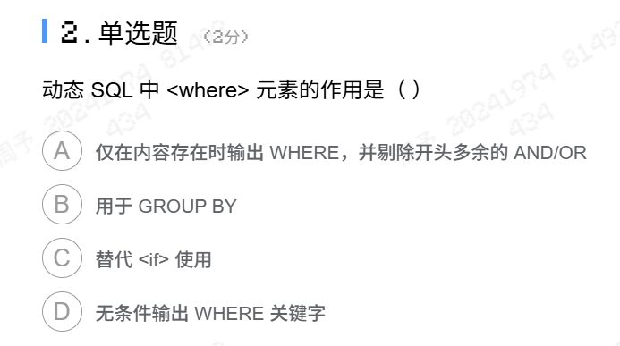

**解答**：A（正确）

**解析**：<where>标签能智能添加WHERE关键字，并剔除多余的AND/OR，防止语法错误。

### 2. 第3题 foreach 指定迭代分隔

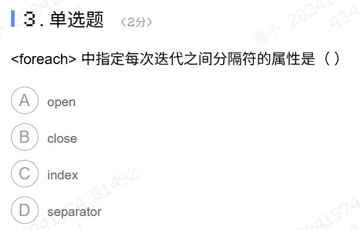

**解答**：D

**解析**：foreach 标签的 separator 属性用于指定每次迭代之间的分隔符。

### 3. 第4题 MyBatis内置数据源默认

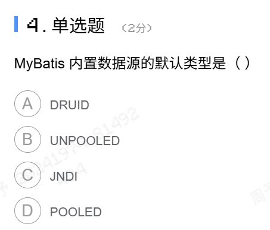

**解答**：B（UNPOOLED）

**解析**：MyBatis内置数据源工厂中，UNPOOLED是默认类型，POOLED是常用类型但非默认。

### 4. 第5题 BaseMapper的sel

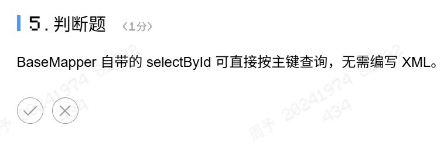

**解答**：正确（√）

**解析**：MyBatis-Plus的BaseMapper内置selectById方法，直接使用即可。

### 5. 第6题 @TableField ex

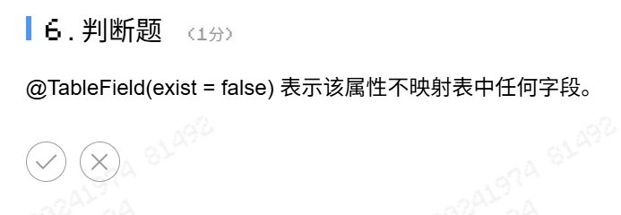

**解答**：错

**解析**：@TableField(exist = false) 表示该属性不是数据库表中的字段，但并非不映射任何字段，说法错误。

### 6. 第8题 MyBatis内置事务管理器

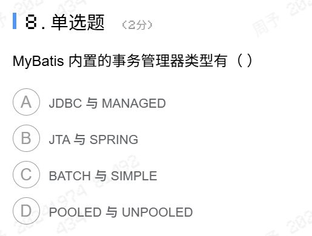

**解答**：A（JDBC与MANAGED）

**解析**：MyBatis内置事务管理器为JDBC和MANAGED，选项A正确。

### 7. 第10题 下划线转驼峰配置项

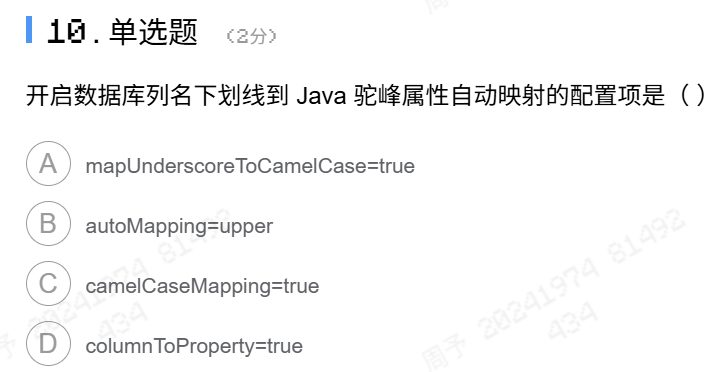

**解答**：A（mapUnderscoreToCamelCase=true）

**解析**：MyBatis 中开启下划线到驼峰映射的配置项是 mapUnderscoreToCamelCase。

### 8. 第11题 MyBatis构建SqlSe

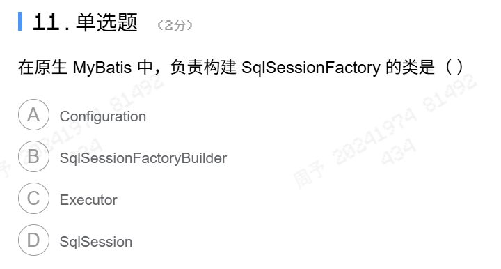

**解答**：B

**解析**：在原生MyBatis中，SqlSessionFactoryBuilder负责解析配置并构建SqlSessionFactory。

### 9. 第12题 foreach 标签 ope

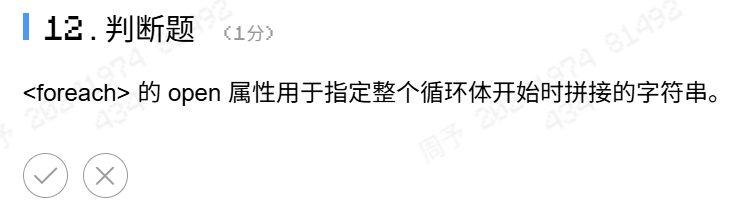

**解答**：×

**解析**：open 属性用于指定循环体开始前拼接的字符串，而非整个循环体开始时。

### 10. 第13题 MyBatis核心配置文件根

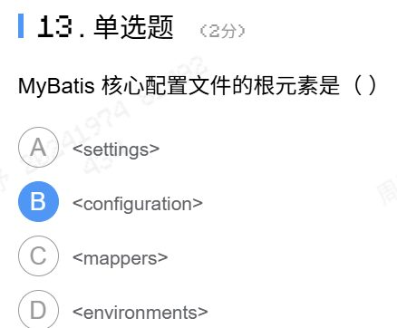

**解答**：B（<configuration>）

**解析**：MyBatis核心配置文件的最外层根标签是<configuration>。

### 11. 第14题 $ 占位符适用场景

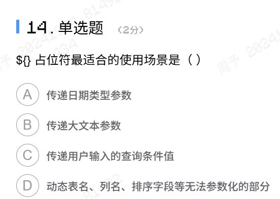

**解答**：D（动态表名、列名、排序字段等无法参数化的部分）

**解析**：`#{}`能防注入并自动加引号，而动态表名等标识符非值，必须用`${}`拼接。

### 12. 第15题 MyBatis中# 能否防止 ⭐

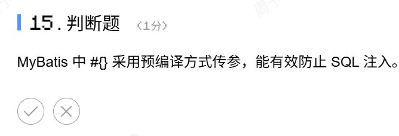

**解答**：对

**解析**：MyBatis的#{}使用占位符进行预编译，能有效防止SQL注入。

**追问 1**：对，答案仍是「对」，但我上次说得太干脆了，补两点更准确的说明：

**为什么算对**
- `#{}` 在 MyBatis 中会被改写成 JDBC 的 `?` 占位符，参数值走 `PreparedStatement.setXxx()` 传进去，**值不会被拼进 SQL 文本**，因此不会被数据库解析成语法，SQL 注入不成立。
- 对比 `${}`：那是直接字符串替换拼接，`order by ${col}`、`like '%${x}%'` 这类才有注入风险。所以「用 `#{}` 能有效防注入」这个命题成立。

**需要打补丁的地方（严格抠字眼时）**
- 「预编译」这个词不严谨。MyBatis 只负责生成 `?`，**是否真在数据库端预编译取决于驱动**：MySQL Connector/J 默认 `useServerPrepStmts=false`，走的是客户端预编译，实质是**转义参数值**再拼接，并非服务端 prepare。
- 但即使如此，**防注入的结论不变**——关键是参数与 SQL 结构分离，不是靠「预编译」这四个字。
- 唯一失效场景：把 `#{}` 用在表名、列名、`order by` 字段上，会变成字符串常量导致语法错误或语义不对（不是注入，而是功能不正常），这种情况只能用 `${}` + 白名单校验。

结论：题库标准答案选 ✅。

### 13. 第16题 @Param注解的作用

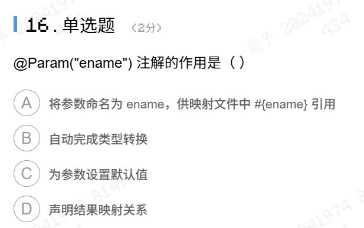

**解答**：A（将参数命名为 ename，供映射文件中 #{ename} 引用）

**解析**：@Param用于给Mapper接口方法参数命名，供XML映射文件通过#{ename}引用，与类型转换、默认值及结果映射无关。

### 14. 第17题 MyBatis二级缓存是否默

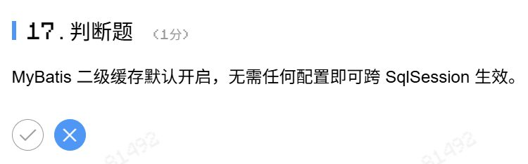

**解答**：×

**解析**：二级缓存默认开启但需配置<cache>标签才生效，且跨SqlSession需提交事务。

### 15. 第18题 MyBatis-Plus默认

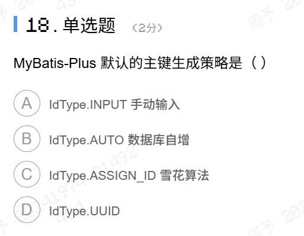

**解答**：C（IdType.ASSIGN_ID 雪花算法）

**解析**：MyBatis-Plus默认使用IdType.ASSIGN_ID，即雪花算法生成分布式唯一ID。

### 16. 第19题 MyBatis中SQL标签i

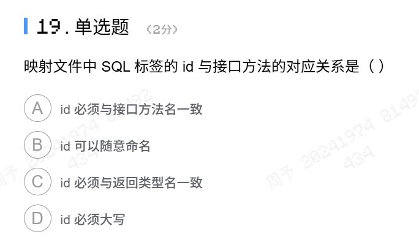

**解答**：A

**解析**：MyBatis映射文件中，SQL标签的id值必须与Mapper接口中的对应方法名完全一致。

### 17. 第20题 @TableLogic注解的

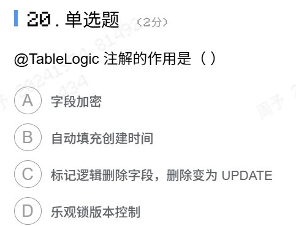

**解答**：C（标记逻辑删除字段，删除变为UPDATE）

**解析**：@TableLogic用于标记逻辑删除字段，执行删除操作时底层SQL会变为UPDATE语句。

### 18. 第21题 MP逻辑删除自动过滤

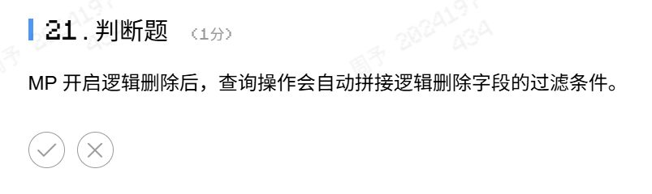

**解答**：对

**解析**：MP开启逻辑删除后，查询操作会自动拼接逻辑删除字段条件以过滤已删除数据。

### 19. 第22题 动态UPDATE消除末尾逗号 ⭐

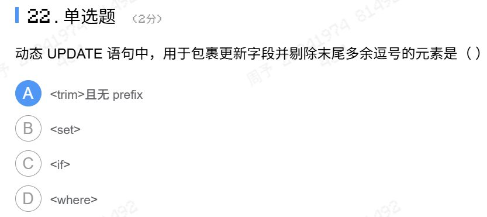

**解答**：B

**解析**：`<set>`标签会自动添加SET关键字并剔除末尾多余逗号，`<trim>`需自定义prefix和suffixOverrides。

**追问 1**：**结论不变，选 B。** 但不是靠"自动"这个词来区分——是我上一条理由给偏了。

题眼的真正落点在"包裹更新字段"这半句：包裹的是一整段字段列表（含 SET 关键字），而不只是"去掉一个逗号"。四个选项里：

- `<where>`、`<if>` 根本不参与去逗号，直接排除。
- 能去末尾逗号的只有 `<trim>` 和 `<set>`。C、D 不用谈。
- A 是标准陷阱：`<trim>` **无 prefix** 时，只会执行 `suffixOverrides=","` 去逗号，不会补 SET。那你必须在外层手写 `update t set`，标签只完成一半工作，也就谈不上"包裹更新字段"。能等价于 `<set>` 的写法是 `<trim prefix="SET" suffixOverrides=",">`——注意它**必须有 prefix**，选项 A 偏偏写"且无 prefix"，就是冲这个来的。

顺带说个可以佐证的事实：MyBatis 的 `<set>` 本身就是用 `<trim prefix="SET" suffixOverrides=",">` 实现的，两者同源。所以出题人给的"正确 trim"必然是带 prefix 的那版；写成"无 prefix"，功能上就残缺了，自然判错。

一句话：这题挑的是"哪个元素专职包裹 UPDATE 的字段列表"，`<set>` 是唯一无争议的答案；A 不是错在"不自动"，是错在"只有半截功能"。

### 20. 第23题 MyBatis-Plus 主

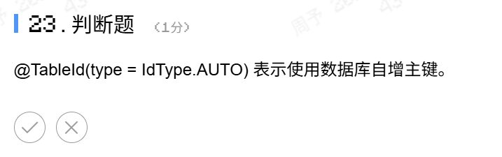

**解答**：对

**解析**：@TableId(type = IdType.AUTO) 确实表示主键由数据库自增生成，说法正确。

### 21. 第24题 MyBatis模糊查询推荐写

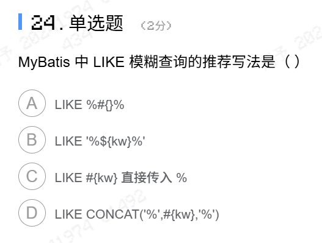

**解答**：D（正确）

**解析**：选项A语法错误，选项B有SQL注入风险，选项C需手动处理百分号，选项D是安全规范写法。

### 22. 第25题 MP 批量插入的 IServ

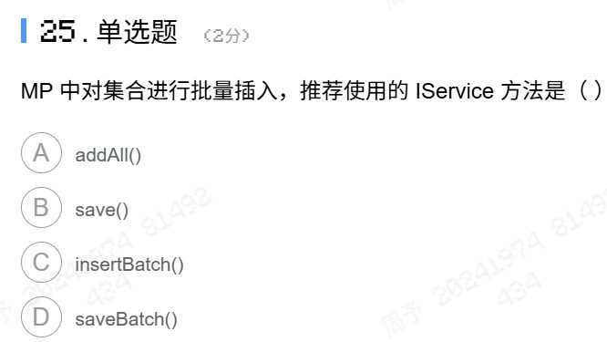

**解答**：D（saveBatch()）

**解析**：MyBatis-Plus 的 IService 接口中批量插入集合的标准方法为 saveBatch()。

### 23. 第26题 MyBatis二级缓存作用域

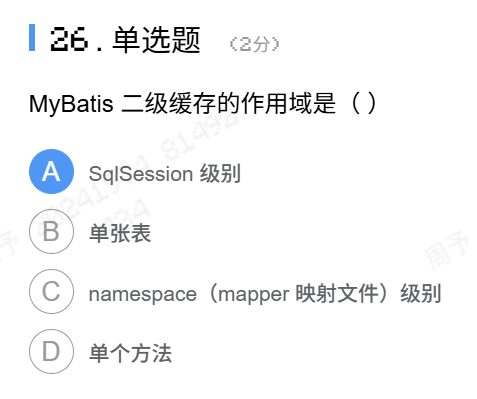

**解答**：C（namespace（mapper映射文件）级别）

**解析**：MyBatis二级缓存以namespace（mapper映射文件）为单位进行缓存，默认关闭。

### 24. 第27题 @Version注解配合哪个

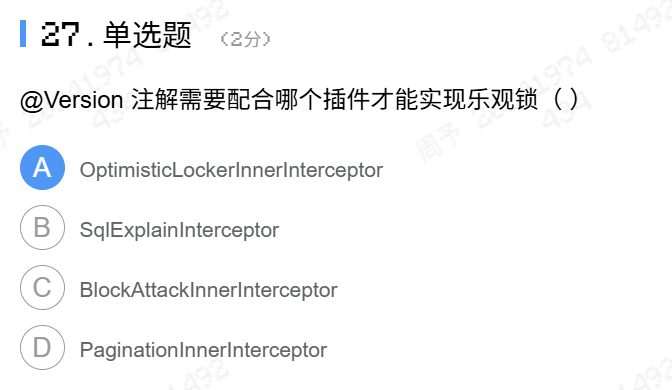

**解答**：A（OptimisticLockerInnerInterceptor）

**解析**：MyBatis-Plus中，@Version注解需配合OptimisticLockerInnerInterceptor插件才能生效。

### 25. 第28题 SqlSession使用方式

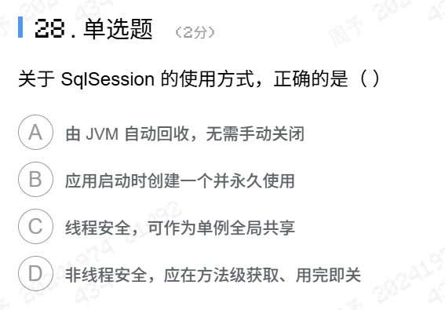

**解答**：D（-1）

**解析**：SqlSession由SqlSessionFactory创建，非线程安全，用完必须关闭。

**追问 1**：没有意义，是我格式里的一个残留占位符，请忽略它——本题只看 `ANS: D`。

进一步说清楚这道题本身：

- **SqlSessionFactory** 才是线程安全、通常全局单例（应用启动时建一次，B 的正确对象是它，不是 SqlSession）。
- **SqlSession** 非线程安全，且持有 Connection/事务，必须用完即关，一般在方法级（try-with-resources 或 finally）获取和关闭。
- A 错在「JVM 自动回收」——GC 只回收内存对象，不会归还数据库连接，池化连接不关会耗尽；C 错在把它当单例共享。

所以答案 D。以后我输出的 `ANS` 行只取选项字母即可。

### 26. 第29题 QueryWrapper l

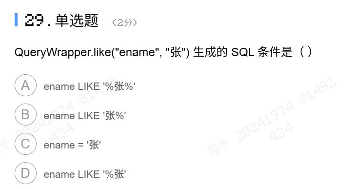

**解答**：A

**解析**：like方法默认进行全模糊匹配，会在参数两侧自动添加百分号。

### 27. 第30题 MyBatis是自动ORM且

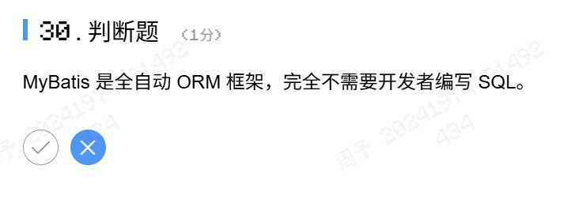

**解答**：×

**解析**：MyBatis是半自动ORM框架，开发者需手动编写SQL。

### 28. 第31题 实体类中数据库不存在的字段注

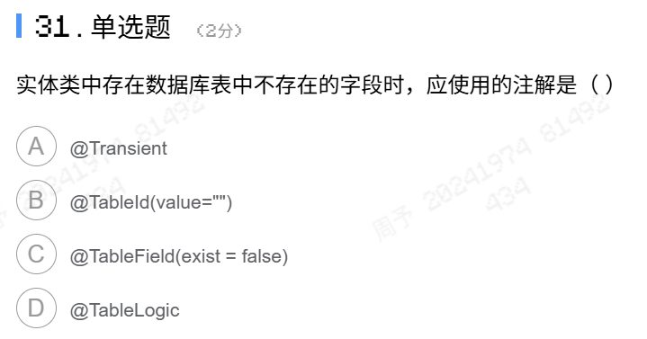

**解答**：C（@TableField(exist = false)）

**解析**：MyBatis-Plus中，@TableField(exist = false)用于标识实体类中非数据库表字段的属性。

### 29. 第33题 SQL注入风险判断 ⭐

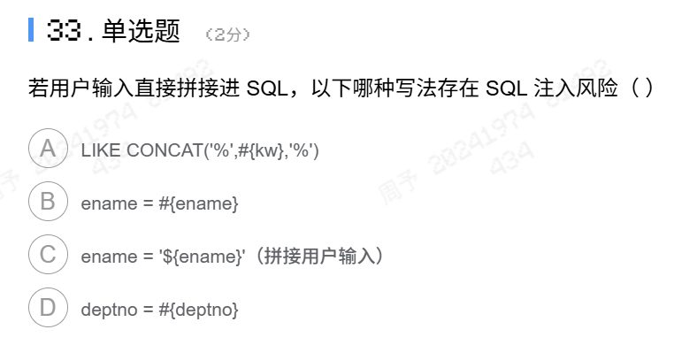

**解答**：C（正确）

**解析**：${}是直接拼接用户输入，会导致SQL注入；#{}是预编译参数化查询，能防止注入。

**追问 1**：确定，答案是 **C**。你记反了：MyBatis 里是 **`#{}` 预编译**，**`${}` 是字符串拼接**。

依据（MyBatis 的两种取值语法本质不同）：

| 写法 | 底层机制 | 安全性 |
|---|---|---|
| `#{}` | 生成 `?` 占位符 → `PreparedStatement`，用 `setXxx()` 传值，SQL 先编译后填参 | 参数永远被当「值」，**防注入** |
| `${}` | 纯文本替换，直接把值原样塞进 SQL 字符串，等价于手写字符串拼接 | 用户输入变成 SQL 语法的一部分，**可注入** |

所以：
- A `LIKE CONCAT('%',#{kw},'%')` → 用了 `#{}`，安全（`%` 是写在 SQL 里的字面量，不是用户输入）。
- B `ename = #{ename}`、D `deptno = #{deptno}` → 参数化，安全。
- C `ename = '${ename}'` → `${}` 直接拼用户输入，例如传 `' OR '1'='1`，SQL 就变成 `ename = '' OR '1'='1'`，直接绕过条件 → **注入风险**，题目问的就是它。

容易记混的点：`${}` 常被用来**动态拼接表名、列名、排序字段**（这些位置 `?` 占位符不支持），正因为它是拼接、不预编译，用它才必须严格校验白名单。记法一句话：**`#` = 井号「占位」，`$` = 美元「替换」**。

### 30. 第34题 MyBatis一级缓存失效操

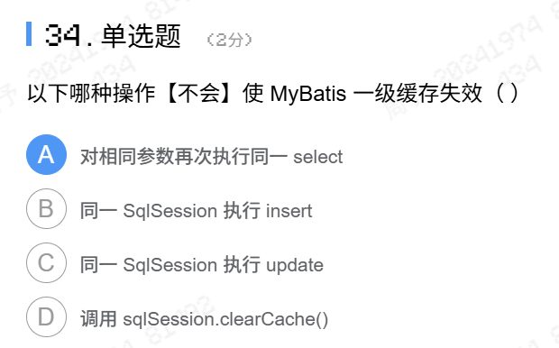

**解答**：A（不会）

**解析**：相同参数再次执行同一 select 会命中一级缓存，不会使其失效。

### 31. 第35题 获取数据库自增主键值的配置

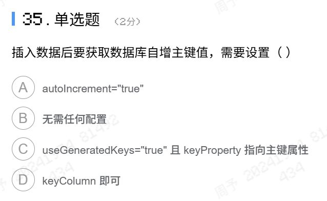

**解答**：C（useGeneratedKeys="true" 且 keyProperty 指向主键属性）

**解析**：MyBatis中需设置useGeneratedKeys为true并指定keyProperty来获取自增主键。

### 32. 第36题 QueryWrapper的g

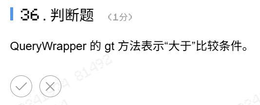

**解答**：对

**解析**：在MyBatis-Plus中，gt是“greater than”的缩写，表示“大于”比较条件，说法正确。

### 33. 第37题 resultMap主键字段映

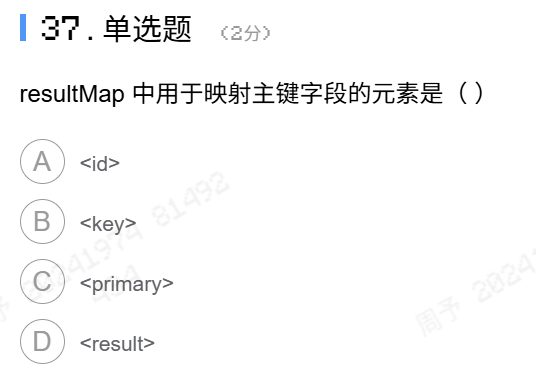

**解答**：A

**解析**：MyBatis的resultMap中，<id>元素专门用于映射数据库主键字段。

### 34. 第38题 实体类别名配置

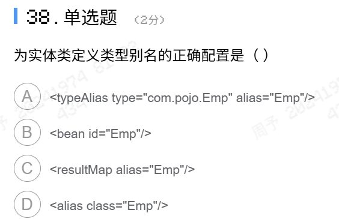

**解答**：A（正确）

**解析**：MyBatis 中 <typeAlias> 标签通过 type 和 alias 属性为实体类定义别名，A 正确。

### 35. 第39题 SqlSession的线程安

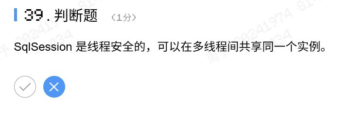

**解答**：错（×）

**解析**：SqlSession 是非线程安全的，不能在多线程间共享同一实例。

### 36. 第40题 Mapper接口映射name

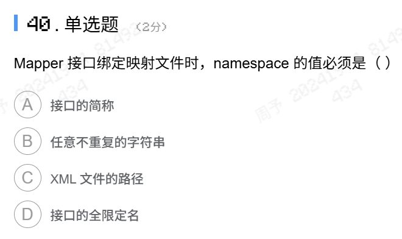

**解答**：D（接口的全限定名）

**解析**：MyBatis绑定Mapper接口时，namespace必须指定为对应接口的全限定名，以建立映射。

### 37. 第41题 动态SQL片段拼接方法

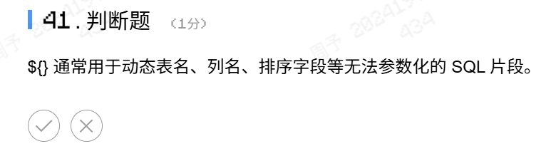

**解答**：对

**解析**：`${}`在MyBatis中用于直接拼接动态SQL，如动态表名、列名、排序字段，无法参数化。

### 38. 第42题 MyBatis 框架的定位

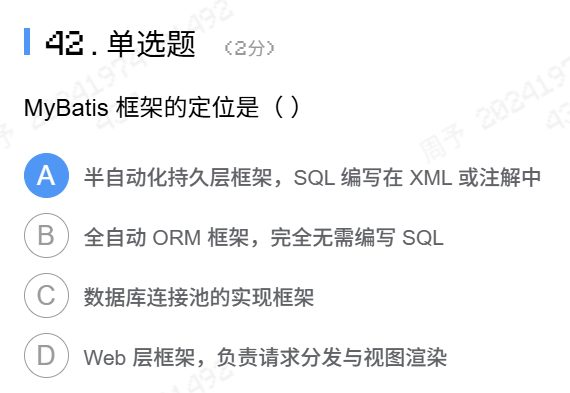

**解答**：A（半自动化持久层框架）

**解析**：MyBatis 是半自动化持久层框架，SQL 需写在 XML 或注解中，并非全自动 ORM。

### 39. 第43题 MyBatis 一级缓存的作

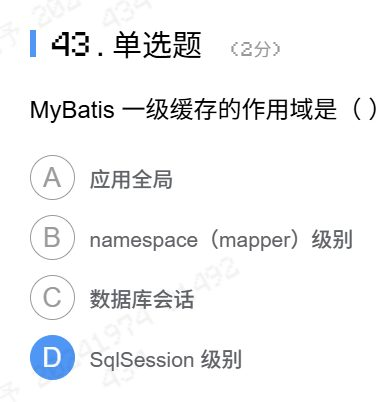

**解答**：D（SqlSession 级别）

**解析**：一级缓存基于 SqlSession 实现，随会话关闭而失效，不同 SqlSession 相互隔离。

### 40. 第44题 MP分页查询是否需配置插件

**解答**：错

**解析**：MyBatis-Plus分页查询需配置分页插件，直接使用Page对象不生效

### 41. 第45题 MyBatis 一级缓存的作

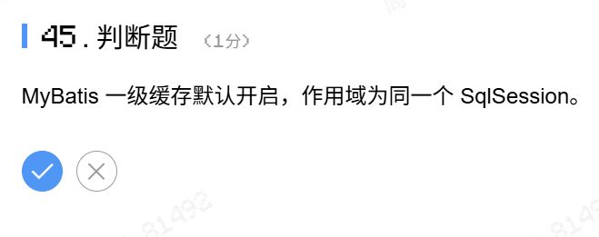

**解答**：对

**解析**：MyBatis 一级缓存确实是默认开启，且作用域严格限制在同一个 SqlSession 内。

### 42. 第46题 选择标签组合功能类似Java

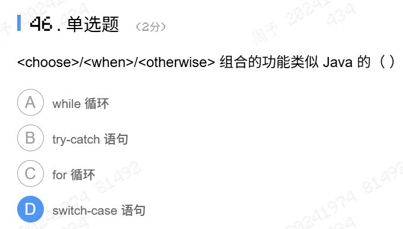

**解答**：D（switch-case 语句）

**解析**：`<choose>/<when>/<otherwise>` 是 MyBatis 中用于多分支条件判断的标签，类似 Java 的 switch-case 语句。

### 43. 第47题 MyBatis 默认是否支持

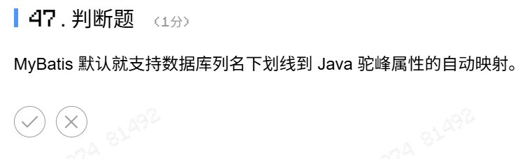

**解答**：错

**解析**：MyBatis 默认关闭该映射，需配置 mapUnderscoreToCamelCase 为 true 才生效。

### 44. 第48题 foreach标签指定集合属

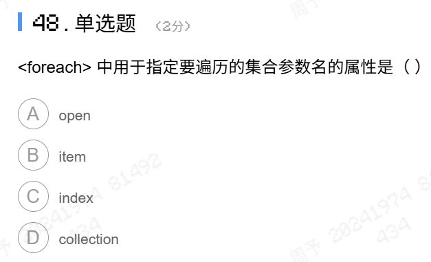

**解答**：D（collection）

**解析**：<foreach>标签的collection属性用于指定要遍历的集合参数名，item、index为其他用途属性。

### 45. 第49题 LambdaQueryWra

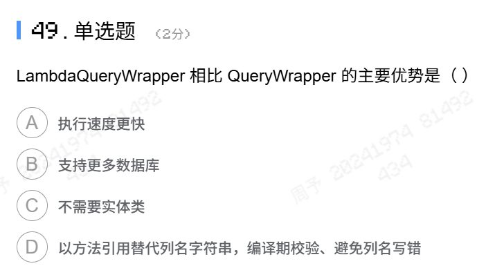

**解答**：D

**解析**：使用Lambda语法引用实体方法替代字符串列名，实现编译期类型校验，避免字段名拼写错误。

### 46. 第50题 # 占位符处理方式

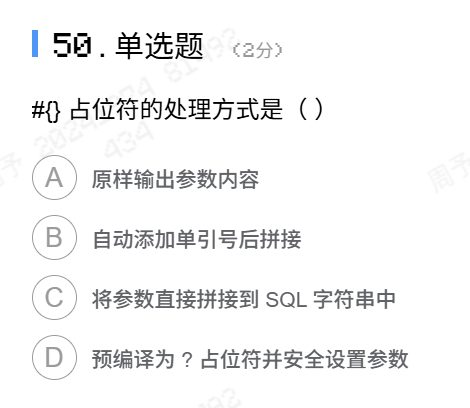

**解答**：D（预编译为？占位符并安全设置参数）

**解析**：#{}会进行预编译，将参数安全地设置为?占位符，能防止SQL注入。

### 47. 第51题 Page对象获取总记录数的方

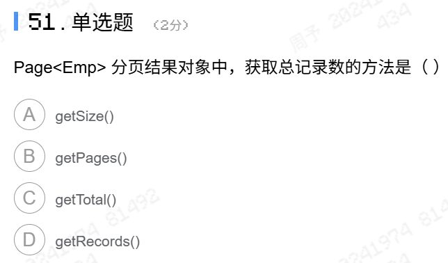

**解答**：C（getTotal()）

**解析**：Page对象的getTotal()方法用于获取总记录数，getRecords()获取当前页数据。

### 48. 第52题 Mapper多参数注解

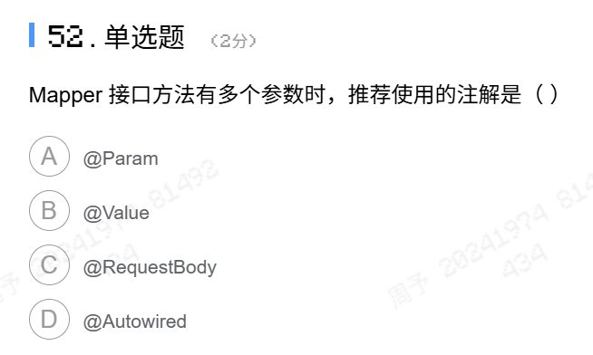

**解答**：A（@Param）

**解析**：MyBatis的Mapper接口多参数时，推荐用@Param注解指定参数名。

### 49. 第53题 MP的updateById默

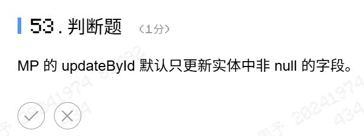

**解答**：对（√）

**解析**：MyBatis-Plus的updateById方法默认策略是仅更新实体中非null的字段。

### 50. 第54题 继承MP的ServiceIm

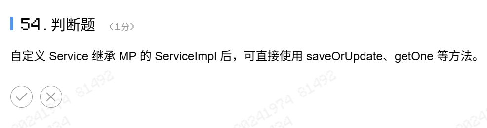

**解答**：错

**解析**：继承ServiceImpl后，通过注入Mapper可获得通用Service方法，但方法调用需符合其定义。

### 51. 第55题 resultMap中处理一对 ⭐

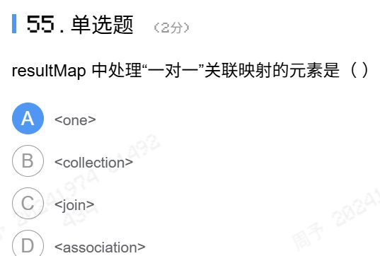

**解答**：D（<association>）

**解析**：resultMap中，`<association>`用于处理一对一关联映射，`<collection>`处理一对多。

**追问 1**：`<one>` 在 MyBatis 里**不存在**，是个纯干扰项 —— 出题人故意用它来碰瓷注解版的 `@One`。

依据：

- resultMap 的合法子元素（由 mybatis-3-mapper.dtd 定义）只有这些：`<constructor>`、`<id>`、`<result>`、`<association>`、`<collection>`、`<discriminator>`（discriminator 内部才有 `<case>`）。没有 `<one>`，也没有 `<join>`。
- 一对一的两种写法：
  - XML：`<association property="..." column="..." javaType="...">`
  - 注解：`@Result(property="...", column="...", one=@One(select="..."))` —— 是 `@One`，不是 `<one>`。
- 一对多对应：XML `<collection>`，注解 `@Many`。

所以 A `<one>`、C `<join>` 都是编出来的标签，唯一正确答案仍是 D `<association>`。（说明：我本想抓 MyBatis 官方 DTD 原文核实，`mybatis.org/dtd` 与 GitHub raw 均被拦截，以上为凭既有知识作答，我有把握。）

### 52. 第56题 @TableName注解的作

**解答**：B（将实体类与数据库表名建立映射）

**解析**：@TableName用于将实体类与数据库表名建立映射关系。

### 53. 第57题 MyBatis insert

**解答**：B（受影响的行数）

**解析**：解析：BaseMapper.insert方法返回int类型，表示成功插入数据库的记录行数。

### 54. 第58题 查询列名与实体属性一致时的映

**解答**：A（使用 resultType 自动映射）

**解析**：结果列名与实体类属性名完全一致时，MyBatis 使用 resultType 即可自动映射，无需手动配置。

### 55. 第59题 MP分页查询需注入的拦截器配

**解答**：A（PaginationInnerInterceptor）

**解析**：MyBatis-Plus分页查询必须配置PaginationInnerInterceptor拦截器并注册为Bean，否则分页失效。

### 56. 第60题 where元素输出WHERE

**解答**：错（×）

**解析**：若内部条件有内容，但整体结果为true，不会输出WHERE关键字。

### 57. MyBatis-Plus的设

**解答**：A

**解析**：MyBatis-Plus的核心设计理念是只做增强不做改变，完全兼容MyBatis的全部功能。

### 58. set元素去除更新语句末尾逗

**解答**：对

**解析**：`<set>` 元素能自动删除多余的逗号，避免SQL语法错误，说法正确。

### 59. Mapper方法名与SQL标 ⭐

**解答**：对

**解析**：绑定不一定失败，若方法上使用@Param等注解或在XML中使用全限定名等方式仍可绑定，故说法错误。

## Spring / SpringMVC

### 60. 第3题 GET请求能否用Reques

**解答**：错

**解析**：GET请求通常没有请求体，虽然SpringMVC支持但不符合规范且常导致参数接收失败，说法错误。

### 61. 第4题 @PathVariable

**解答**：正确

**解析**：@PathVariable 是 Spring 框架中用于获取 URL 路径中占位符参数的注解。

### 62. 第6题 @Transactional

**解答**：错

**解析**：Spring 默认仅对 RuntimeException 和 Error 回滚，IOException 属受检异常，默认不回滚。

### 63. 第7题 解决@Autowired同类 ⭐

**解答**：C（配合@Qualifier("beanName")指定名称）

**解析**：当同一类型存在多个Bean时，可配合@Qualifier注解按名称指定要注入的具体Bean。

### 64. 第9题 Spring主流依赖注入方式 ⭐

**解答**：A（构造器注入、Setter 注入、字段注入）

**解析**：Spring官方和主流认知中的三种注入方式是构造器注入、Setter注入和字段注入。

### 65. 第10题 XML中bean标签属性含义

**解答**：C（Bean 的唯一标识与 Bean 的全限定类名）

**解析**：id用于唯一标识Bean，class用于指定Bean的全限定类名。

### 66. 第12题 不是Spring声明Bean

**解答**：B（-1）

**解析**：在类中直接new对象是手动实例化，不受Spring容器管理，不属于声明Bean的方式。

### 67. 第13题 重定向与转发的返回写法 ⭐

**解答**：C（"redirect:/list" 与 "forward:/list"）

**解析**：SpringMVC中重定向和转发对应的标准视图前缀写法。

### 68. 第14题 IoC本质判断

**解答**：正确

**解析**：IoC即控制反转，本质是将对象创建与依赖装配的控制权交由Spring容器。

### 69. 第15题 构造器注入的特点判断

**解答**：正确

**解析**：构造器注入通过构造方法传参，能确保依赖对象在实例化时完成初始化，避免为 null，且属性可设为 final，有利于对象不可变性。

### 70. 第16题 视图解析器的作用

**解答**：C（把逻辑视图名解析为具体视图对象）

**解析**：ViewResolver负责将控制器返回的逻辑视图名映射为具体的物理视图对象。

### 71. 第17题 Spring Bean的作用 ⭐

**解答**：A（创建一个全新的实例）

**解析**：prototype作用域下，每次请求都会创建一个新的Bean实例。

### 72. 第18题 获取URL查询参数的注解

**解答**：D（@RequestParam）

**解析**：@RequestParam用于获取请求URL中的查询参数，如?name=tom。

### 73. 第19题 SpringMVC接收上传文 ⭐

**解答**：A（MultipartFile）

**解析**：SpringMVC中文件上传通常使用MultipartFile接口来接收上传的文件。

### 74. 第20题 SpringMVC接收JSO

**解答**：A

**解析**：POST请求提交JSON数据，后端应使用@RequestBody注解将请求体绑定到Controller方法参数。

### 75. 第21题 依赖注入 DI 的定义

**解答**：B（容器在创建 Bean 时自动把它依赖的对象注入进来）

**解析**：依赖注入是指容器在创建Bean时，自动将其依赖的对象注入进来。

### 76. 第23题 Service内部调用事务失 ⭐

**解答**：D（内部this调用不经过代理对象，事务增强逻辑不会生效）

**解析**：同类方法内部this调用不经过Spring代理对象，导致事务增强逻辑不生效。

### 77. 第24题 Spring IoC容器常用 ⭐

**解答**：D（BeanFactory 与 ApplicationContext）

**解析**：BeanFactory是底层基础接口，ApplicationContext是其常用高级子接口。

### 78. 第25题 拦截器afterComple

**解答**：对

**解析**：afterCompletion方法在请求处理完成后执行，无论是否发生异常。

### 79. 第26题 @Configuration

**解答**：C（声明配置类，@Bean 方法返回值注册为容器 Bean）

**解析**：@Configuration声明配置类，@Bean将方法返回值注册为Spring容器中的Bean。

### 80. 第27题 AOP切点定义

**解答**：正确

**解析**：AOP中切点确实用于定义通知应该应用在哪些连接点上。

### 81. 第28题 RequestMapping

**解答**：B（将请求URL映射到处理方法或类）

**解析**：@RequestMapping用于建立请求URL与处理器之间的映射关系。

### 82. 第29题 受检异常触发回滚写法

**解答**：A（@Transactional(rollbackFor = Exception.class)）

**解析**：@Transactional 默认只回滚 RuntimeException，需用 rollbackFor 指定受检异常。

### 83. 第30题 Autowired注解装配方

**解答**：错

**解析**：@Autowired默认按类型装配，名称仅作辅助，并非只能按名称。

### 84. 第32题 SpringMVC处理请求组

**解答**：D

**解析**：SpringMVC核心执行流程依次经过前端控制器、映射器、适配器、处理器和视图解析器。

### 85. 第33题 @Transactional

**解答**：×

**解析**：默认只对 public 方法生效，但可通过配置改变，并非绝对。

### 86. 第34题 SpringMVC默认集成J ⭐

**解答**：对

**解析**：SpringMVC默认已内置Jackson集成，只要类路径存在Jackson依赖即可自动将对象转换为JSON返回。

### 87. 第35题 Spring AOP与Asp ⭐

**解答**：×

**解析**：说反了，Spring AOP是运行期动态代理，AspectJ才是编译期织入。

### 88. 第36题 Transactional默 ⭐

**解答**：B（仅 RuntimeException 与 Error）

**解析**：@Transactional默认只对RuntimeException和Error回滚，受检异常不回滚。

### 89. 第37题 事务传播行为REQUIRED ⭐

**解答**：C（存在事务则加入，没有则新建）

**解析**：Spring中REQUIRED表示当前有事务则加入，无事务则新建一个事务。

### 90. 第38题 RestController

**解答**：对

**解析**：该注解是@ResponseBody和@Controller的结合，默认将返回对象转为JSON写入响应体。

### 91. 第39题 ApplicationCon

**解答**：B

**解析**：BeanFactory是延迟加载，ApplicationContext启动时创建所有单例Bean。

### 92. 第40题 Spring框架最核心特性

**解答**：D（正确）

**解析**：Spring框架最核心的特性是IoC（控制反转）和AOP（面向切面编程）。

### 93. 第41题 视图解析器能否整合Thyme

**解答**：×

**解析**：Spring MVC的视图解析器可配置支持JSP、Thymeleaf等多种模板引擎，说法错误。

### 94. 第42题 Spring默认作用域判断 ⭐

**解答**：正确

**解析**：Spring中Bean默认作用域确实是singleton，容器中每个Bean只有一个实例，说法正确。

### 95. 第43题 启用注解组件扫描配置标签

**解答**：C（<context:component-scan base-package="..."/>）

**解析**：context:component-scan 标签用于开启组件扫描，base-package 指定扫描包。

### 96. 第45题 DispatcherServ

**解答**：正确（√）

**解析**：DispatcherServlet需在web.xml或配置类中注册，这是SpringMVC正常启动的必要条件。

### 97. 第46题 @Controller方法返 ⭐

**解答**：A（视图名称）

**解析**：在@Controller类中，方法返回字符串默认被当作视图名称，交给视图解析器处理。

### 98. 第47题 @Value注解的作用 ⭐

**解答**：A（将配置文件中的属性值注入到字段）

**解析**：@Value("${jdbc.url}")用于读取配置文件中的属性值并注入到对应字段。

### 99. 第49题 Spring注解派生与组件扫 ⭐

**解答**：正确

**解析**：@Service、@Repository、@Controller均组合了@Component，可被组件扫描识别。

### 100. 第50题 Around通知是否必须调用 ⭐

**解答**：对

**解析**：@Around通知中若不调用proceed()，目标方法确实不会执行，说法正确。

### 101. 第51题 SpringMVC拦截器pr

**解答**：D（请求被终止，不再执行控制器）

**解析**：preHandle返回false时请求被中断，不会执行控制器方法，但已执行的拦截器afterCompletion仍会调用（选项A表述不完整）

### 102. 第52题 获取URL路径变量的写法

**解答**：A（@RequestMapping("/emp/{id}") 配合 @PathVariable Integer id）

**解析**：@PathVariable配合@RequestMapping中的{id}占位符可获取路径上的值。

### 103. 第53题 Spring Bean 默认

**解答**：A（singleton）

**解析**：Spring 框架中 Bean 默认的作用域是 singleton（单例）。

### 104. 第54题 @Resource注解匹配顺

**解答**：对

**解析**：@Resource是JDK提供，默认先按名称匹配，名称找不到再按类型匹配。

### 105. 第55题 AspectJ切点匹配包下所

**解答**：D（execution(* com.service..*(..))）

**解析**：execution(* com.service..*(..)) 用于匹配 com.service 包及其子包下所有类的所有方法。

### 106. 第56题 Spring AOP默认代理 ⭐

**解答**：D（目标有接口时用 JDK 动态代理，无接口时用 CGLIB）

**解析**：Spring AOP 默认规则是目标类有接口用 JDK 动态代理，无接口用 CGLIB。

### 107. 第57题 全局异常处理的注解组合

**解答**：A（@ControllerAdvice + @ExceptionHandler）

**解析**：@ControllerAdvice 配合 @ExceptionHandler 可实现全局异常处理。

### 108. 第58题 注解能否同方法使用 ⭐

**解答**：正确

**解析**：@RequestBody 用于接收请求体，@ResponseBody 用于返回数据体，两者作用不同，可同时用于同一方法。

### 109. 第59题 声明式事务管理注解

**解答**：A（-1）

**解析**：Spring声明式事务管理通过@Transaction注解实现

### 110. 第60题 AOP中通知Advice的描

**解答**：B（在切点处执行的增强逻辑及执行时机）

**解析**：通知（Advice）定义了在切点处执行的增强逻辑以及具体的执行时机。

### 111. 标注持久层DAO的注解 ⭐

**解答**：B（@Repository）

**解析**：@Repository用于将数据访问层（DAO）类识别为Bean。
