# 移动应用开发

> Spore 搜题记录汇总 · 共 **56** 题（有截图 56 题）· 时间 2026-11-20 ~ 2026-11-20
> 来源：Spore-MV3 56 题 · 导出 2026-11-21

## Android 数据存储与生命周期

### 1. 第2题 SQLite特点的错误说法

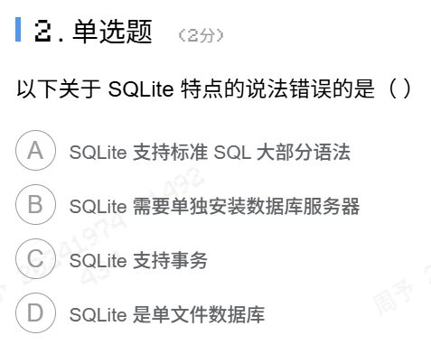

**解答**：B（-1）

**解析**：SQLite是嵌入式数据库，无需单独安装数据库服务器，B说法错误。

### 2. 第3题 SQLite查询返回的结果集 ⭐

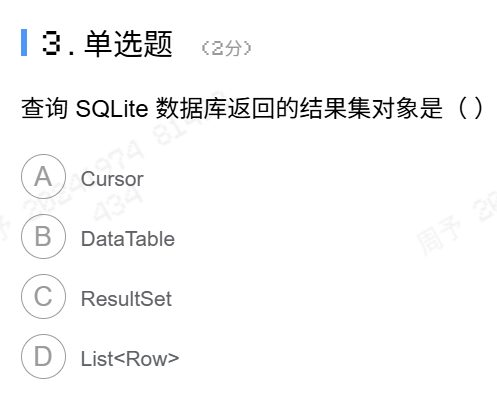

**解答**：A（Cursor）

**解析**：Python操作SQLite时，执行查询后返回的是游标对象Cursor，用于遍历结果。

### 3. 第4题 Activity的onCre

**解答**：错（×）

**解析**：Activity生命周期中onCreate仅在创建时调用一次，不可多次调用。

### 4. 第5题 SQLiteDatabase ⭐

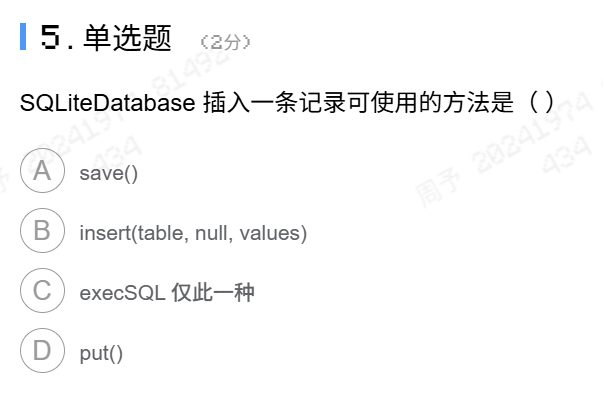

**解答**：B（insert(table, null, values)）

**解析**：insert()方法用于向SQLite数据库插入数据，参数为表名、空列占位符和值。

### 5. 第6题 内存不足回收后恢复调用生命周 ⭐

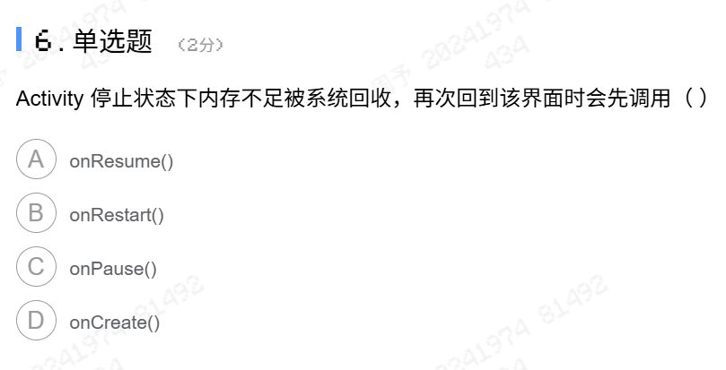

**解答**：D（onCreate()）

**解析**：Activity被系统回收后重建，再次回到界面首先执行onCreate()。

### 6. 第7题 隐式Intent匹配依据 ⭐

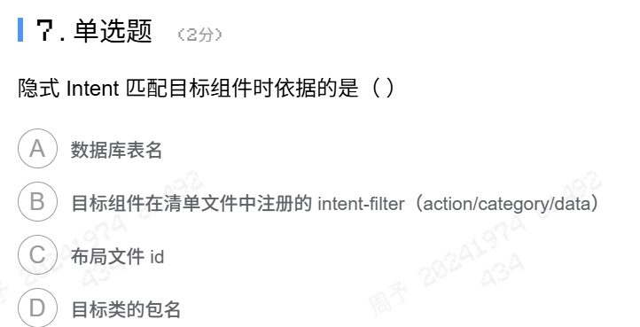

**解答**：B（intent-filter（action/category/data））

**解析**：隐式Intent通过action、category、data与清单文件中的intent-filter进行匹配。

### 7. 第8题 线性布局子控件垂直排列设置

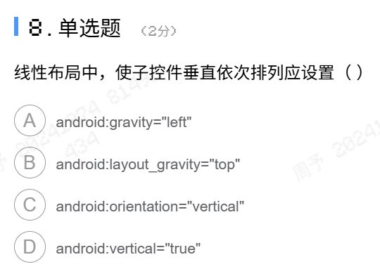

**解答**：C

**解析**：线性布局中，orientation属性设为vertical可使子控件垂直依次排列。

### 8. 第9题 Cursor遍历结果集标准写

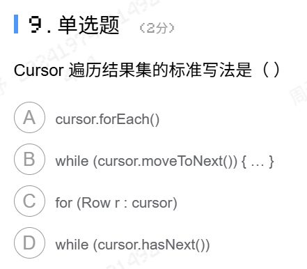

**解答**：B

**解析**：while (cursor.moveToNext()) 是Android/Java中Cursor遍历的标准写法。

### 9. 第10题 内部存储文件写入核心方法 ⭐

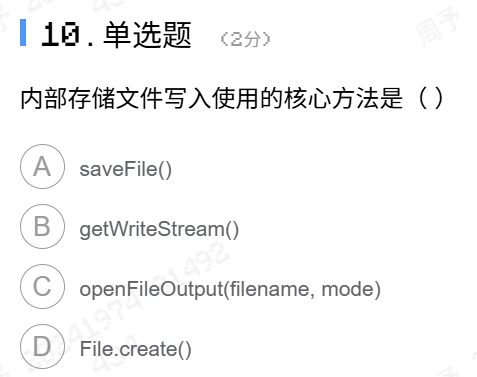

**解答**：C（openFileOutput(filename, mode)）

**解析**：Android 内部存储写文件需用 openFileOutput() 获取输出流，其余选项均非核心方法。

### 10. 第11题 Activity返回结果的方

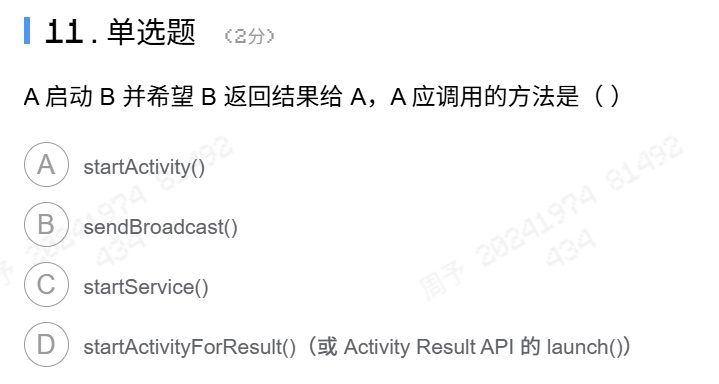

**解答**：D（startActivityForResult()）

**解析**：startActivityForResult() 专用于启动新Activity并接收其返回结果。

### 11. 第12题 Intent传递多个值推荐的 ⭐

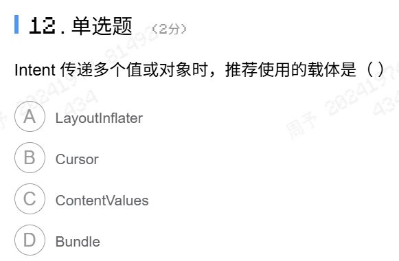

**解答**：D（Bundle）

**解析**：Intent传递数据时，Bundle可封装多个值或对象，是推荐的载体。

### 12. 第13题 finish 方法的作用

**解答**：正确

**解析**：在Android开发中，调用finish()方法确实会结束并关闭当前的Activity。

### 13. 第14题 SQLite是否为Andro

**解答**：正确（√）

**解析**：SQLite是Android系统内置的轻量级关系型数据库，开发者可直接使用，无需额外安装。

### 14. 第15题 SQLiteDatabase ⭐

**解答**：正确

**解析**：SQLiteDatabase的query()方法执行查询并返回一个Cursor对象，用于遍历结果集。

### 15. 第16题 Activity 完全不可见 ⭐

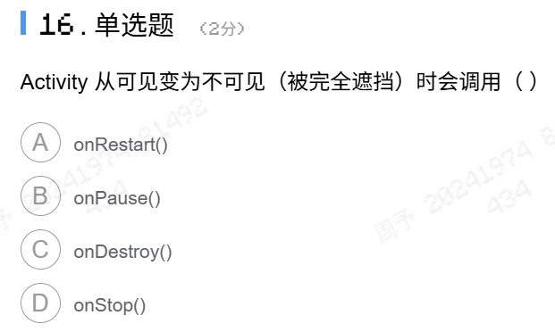

**解答**：D（onStop()）

**解析**：在 Android 生命周期中，Activity 从可见变为完全不可见被遮挡时会调用 onStop() 方法。

### 16. 第17题 Android内置轻量级关系

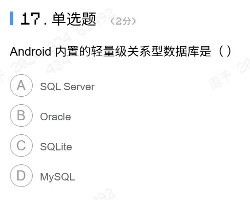

**解答**：C（SQLite）

**解析**：SQLite是Android系统内置的轻量级关系型数据库，其他选项均非内置。

### 17. 第18题 onCreate方法的作用

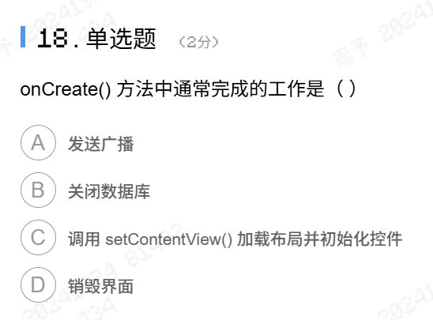

**解答**：C（调用 setContentView() 加载布局并初始化控件）

**解析**：onCreate中通常调用setContentView加载布局并初始化控件，属于Activity生命周期基础知识。

### 18. 第19题 ContentValues键

**解答**：对

**解析**：ContentValues用于存储键值对，其键代表数据库表中的列名。

### 19. 第20题 Cursor资源释放

**解答**：对

**解析**：数据库游标使用完毕后调用close()方法可以释放资源，该说法正确。

### 20. 第21题 获取SharedPrefer

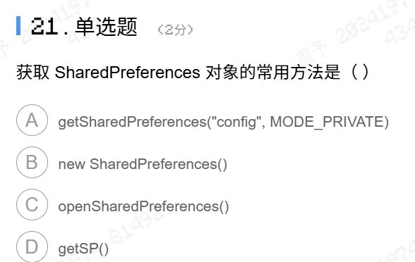

**解答**：A（getSharedPreferences("config", MODE_PRIVATE)）

**解析**：在Android中，获取SharedPreferences对象的常用方法是Context的getSharedPreferences()方法。

### 21. 第22题 获取启动Intent的方法

**解答**：正确

**解析**：在Android开发中，目标页面确实是通过getIntent()方法来获取启动它的Intent及数据的。

### 22. 第23题 Activity启动是否必须 ⭐

**解答**：对

**解析**：Activity必须在AndroidManifest.xml中注册才能启动，未注册会抛出异常。

### 23. 第24题 数据库表结构变更处理位置

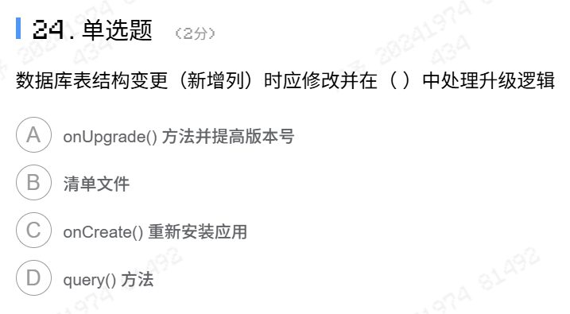

**解答**：A（onUpgrade() 方法并提高版本号）

**解析**：SQLiteOpenHelper中版本升级会回调onUpgrade方法，新增列需在此处理并提高版本号。

### 24. 第25题 MODE_APPEND模式的

**解答**：正确

**解析**：MODE_APPEND 是文件打开模式，作用是在原文件末尾追加内容，不会覆盖原有内容，说法正确。

### 25. 第26题 openFileOutput

**解答**：对

**解析**：openFileOutput默认模式为MODE_PRIVATE，即私有，对其他应用不可见。

### 26. 第27题 为Button设置点击事件监

**解答**：B（setOnClickListener(new View.OnClickListener(){...})）

**解析**：在Android开发中，为按钮设置点击事件监听器的标准方法是调用setOnClickListener。

### 27. 第28题 putExtra传递对象

**解答**：正确

**解析**：putExtra支持传递基本类型、String以及实现了Serializable或Parcelable接口的对象。

### 28. 第29题 SharedPreferen ⭐

**解答**：错

**解析**：SharedPreferences仅适合存储少量简单键值对，不适合大量结构化列表数据。

### 29. 第30题 Activity与用户界面关

**解答**：正确（✓）

**解析**：Activity是Android四大组件之一，通常一个Activity对应一个屏幕界面。

### 30. 第31题 Android退出当前Act ⭐

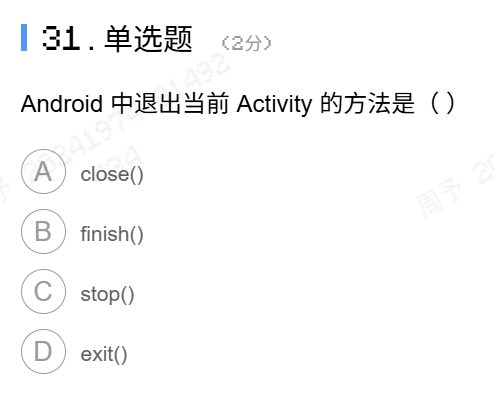

**解答**：B（finish()）

**解析**：finish() 方法用于结束当前 Activity 并将其从栈中移除。

### 31. 第32题 SQLiteOpenHelp ⭐

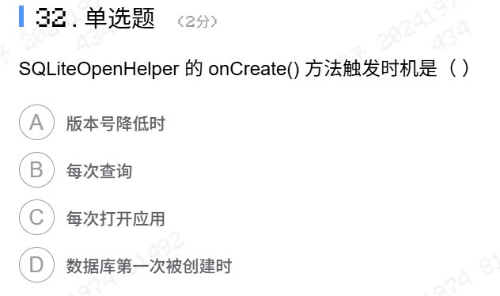

**解答**：D（数据库第一次被创建时）

**解析**：onCreate()仅在数据库文件第一次被创建时调用，用于初始化表结构。

### 32. 第33题 页面返回结果的方法 ⭐

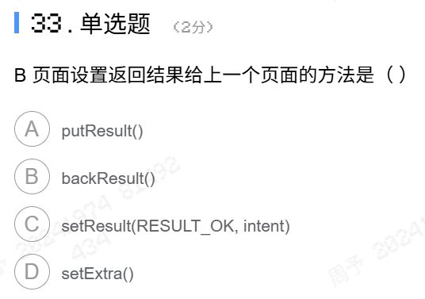

**解答**：C（setResult(RESULT_OK, intent)）

**解析**：在Android中，B页面设置返回结果给上一个页面需调用setResult方法，并传入结果码和携带数据的Intent。

### 33. 第34题 Android四大组件不包括

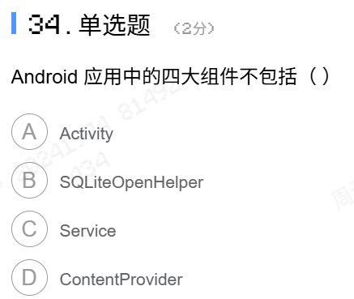

**解答**：B（SQLiteOpenHelper）

**解析**：SQLiteOpenHelper是数据库辅助类，非四大组件（Activity、Service、BroadcastReceiver、ContentProvider）。

### 34. 第35题 SharedPreferen

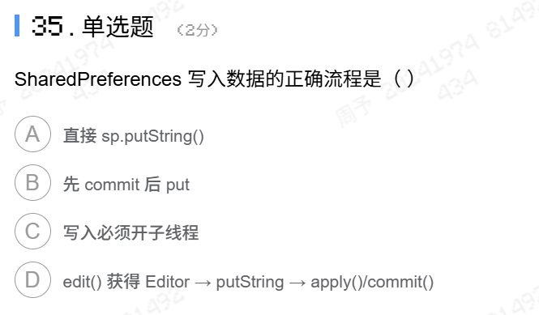

**解答**：D（D）

**解析**：SharedPreferences写入需先通过edit()获取Editor，再put数据，最后apply或commit提交。

### 35. 第36题 SQLite数据库辅助类 ⭐

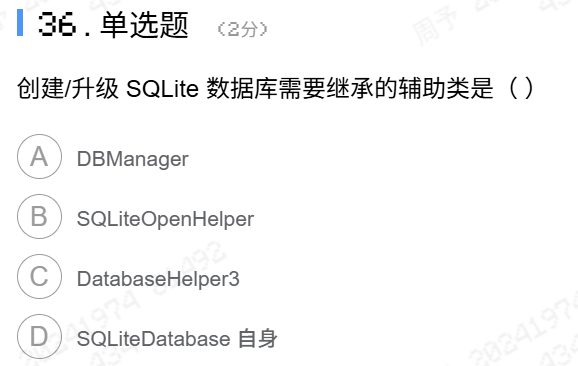

**解答**：B（SQLiteOpenHelper）

**解析**：创建或升级SQLite数据库通常需要继承SQLiteOpenHelper类，而非选项所列。

### 36. 第37题 显式Intent启动Acti

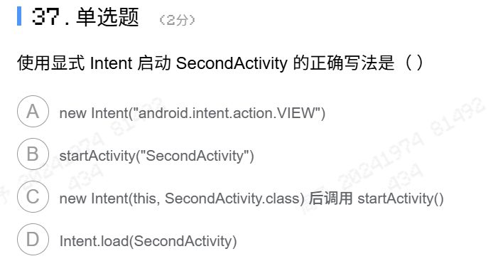

**解答**：C（正确）

**解析**：显式Intent需指定上下文和目标类，C项使用new Intent(this, SecondActivity.class)后调用startActivity()是标准写法。

### 37. 第38题 登录用户名持久化存储 ⭐

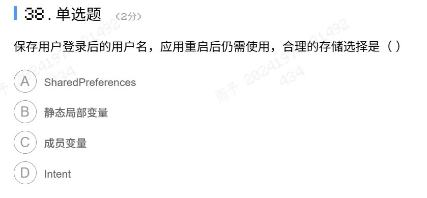

**解答**：A（SharedPreferences）

**解析**：SharedPreferences 可将数据持久化保存到文件，应用重启后数据依然存在。

### 38. 第41题 SharedPreferen ⭐

**解答**：错

**解析**：commit()是同步提交，apply()才是异步提交，故说法错误。

### 39. 第42题 Intent中putExtr ⭐

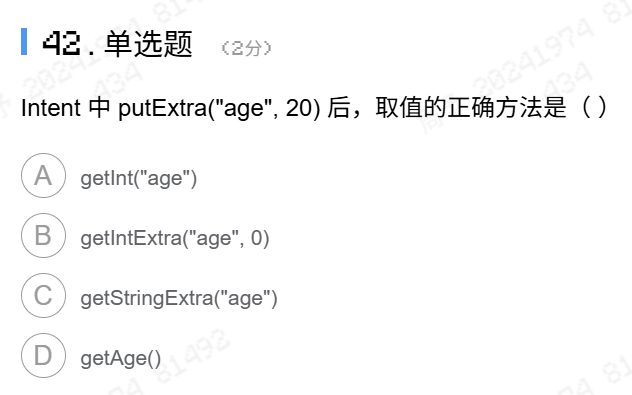

**解答**：B（getIntExtra("age", 0)）

**解析**：存入的是int类型数据，应使用getIntExtra("age", 默认值)方法获取。

### 40. 第44题 显式Intent的特点 ⭐

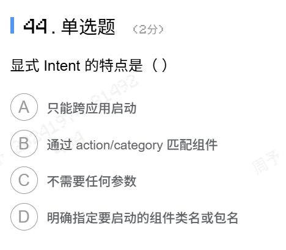

**解答**：D（明确指定要启动的组件类名或包名）

**解析**：显式Intent通过明确指定组件类名或包名来启动目标组件。

### 41. 第45题 onUpgrade回调时机 ⭐

**解答**：正确

**解析**：SQLiteOpenHelper的onUpgrade()确实在数据库版本号提高时被回调。

### 42. 第46题 启动Activity需在清单 ⭐

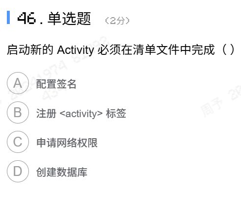

**解答**：B（注册<activity>标签）

**解析**：Android中启动新的Activity必须在AndroidManifest.xml中注册该Activity标签。

### 43. 第47题 openFileOutput ⭐

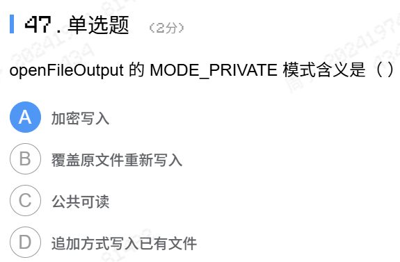

**解答**：B（覆盖原文件重新写入）

**解析**：MODE_PRIVATE表示私有模式，覆盖原文件写入，仅当前应用可访问。

### 44. 第48题 获取Intent字符串参数写 ⭐

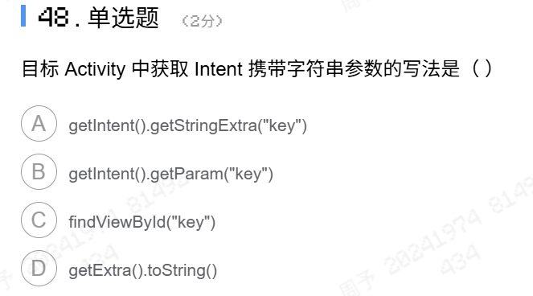

**解答**：A（getIntent().getStringExtra("key")）

**解析**：在Android中获取Intent携带的字符串参数需调用getStringExtra方法。

### 45. 第49题 LinearLayout排列

**解答**：正确

**解析**：LinearLayout确实通过orientation属性（取值为horizontal或vertical）来控制子控件的排列方向，说法正确。

### 46. 第49题 SharedPreferen ⭐

**解答**：正确

**解析**：SharedPreferences 确实是以 XML 文件形式来存储键值对数据的。

### 47. 第51题 少量简单键值对配置的存储方式 ⭐

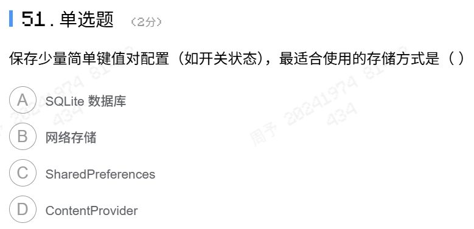

**解答**：C（SharedPreferences）

**解析**：SharedPreferences 专用于以键值对形式保存少量简单配置数据。

### 48. 第52题 界面返回生命周期 ⭐

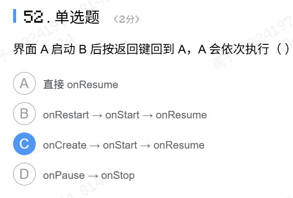

**解答**：B（onRestart → onStart → onResume）

**解析**：界面B销毁后，A从后台回到前台依次执行onRestart、onStart、onResume。

### 49. 第53题 生命周期只执行一次的方法

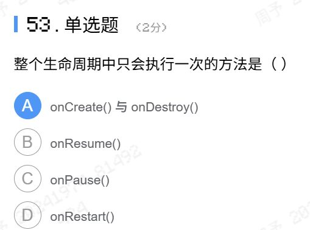

**解答**：A（onCreate() 与 onDestroy()）

**解析**：onCreate在创建时调用一次，onDestroy在销毁时调用一次，二者均仅执行一次。

### 50. 第55题 Android数据存储方式正

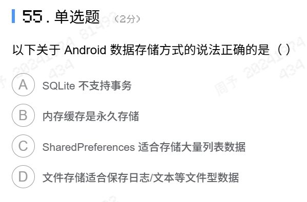

**解答**：D

**解析**：文件存储常用于保存日志、文本等文件型数据，SQLite支持事务，内存缓存非永久，SharedPreferences不适合大量列表。

### 51. 第56题 Activity的onRes

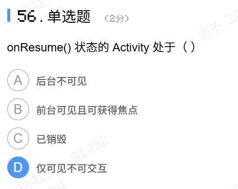

**解答**：B（前台可见且可获得焦点）

**解析**：onResume()表示Activity不仅可见，而且位于前台并获得焦点，可与用户交互。

### 52. 第57题 Activity生命周期状态 ⭐

**解答**：×

**解析**：onPause时Activity仅部分不可见，onStop时才完全不可见。

### 53. 第58题 Intent传递基本类型参数

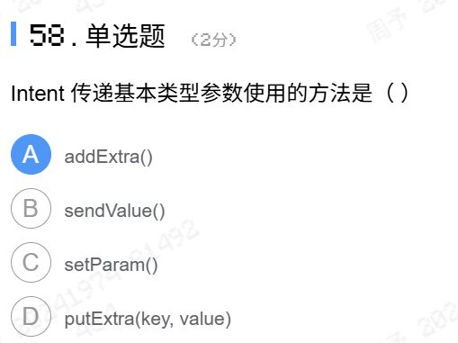

**解答**：D（putExtra(key, value)）

**解析**：putExtra(key, value) 是 Intent 传递基本类型数据的标准方法，A、B、C 均非正确 API。

### 54. 第59题 显式Intent匹配方式 ⭐

**解答**：错

**解析**：显式Intent通过指定组件名（ComponentName）来匹配，action属性用于隐式Intent。

### 55. 第60题 控件水平居中属性

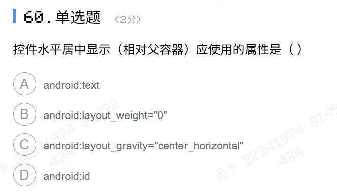

**解答**：C（android:layout_gravity="center_horizontal"）

**解析**：layout_gravity属性用于设置控件相对于父容器的对齐方式，center_horizontal表示水平居中。

### 56. Home键后Activity

**解答**：对

**解析**：按Home键回到桌面，Activity先失去焦点执行onPause，完全不可见后执行onStop，说法正确。
