# 计算机网络

> Spore 搜题记录汇总 · 共 **122** 题（有截图 57 题）· 时间 2026-10-05 ~ 2026-10-10
> 来源：Spore-GUI 122 题 · 导出 2026-11-21

分卷：CN-作业2（68 题）、CN-阶测1（54 题）

## CN-作业2

### 1. 第4题 不能分配给Internet主机的IP地址

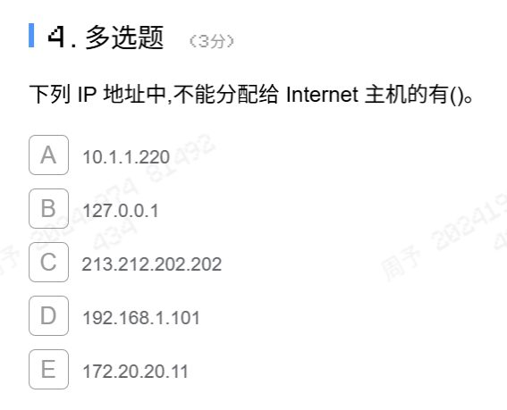

**解答**：A、B、D、E

**解析**：10.1.1.220、127.0.0.1、192.168.1.101、172.20.20.11均为私网或回环地址，不能直接分配给Internet主机；213.212.202.202为公网地址。

### 2. 第6题 IPv4过渡到IPv6的技术

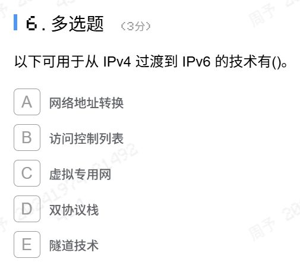

**解答**：A（√）D（√）E（√）

**解析**：网络地址转换、双协议栈和隧道技术是公认的IPv4向IPv6过渡的三大核心技术。

### 3. 第9题 TCP和UDP的说法辨析

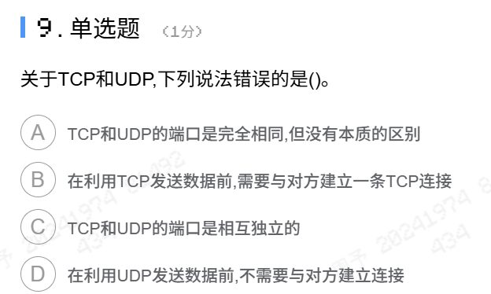

**解答**：A（错误）

**解析**：TCP和UDP端口号分配独立，互不影响，且本质区别在于传输方式，说法A错误。

### 4. 第10题 路由表是否需包含完整路径信息

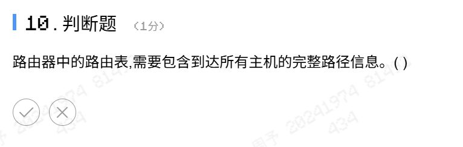

**解答**：×

**解析**：路由表仅需包含下一跳或出接口，无需存储到达所有主机的完整路径信息，因此此说法错误。

### 5. 第12题 D类地址的用途判断

**解答**：对

**解析**：D类地址（224.0.0.0～239.255.255.255）专门用于多播（组播），与多址投递系统一致。

### 6. 第13题 求网络地址的广播地址

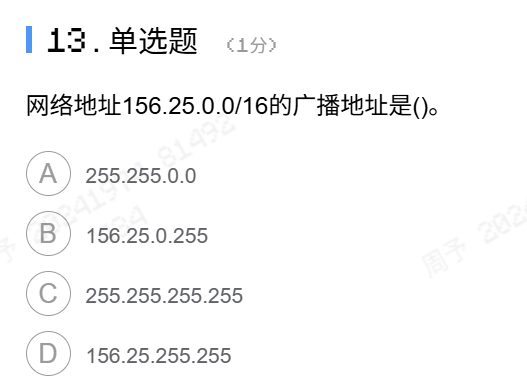

**解答**：D（156.25.255.255）

**解析**：/16掩码下广播地址为主机位全1，即后两字节255，保持前两字节156.25不变。

### 7. 第14题 TCP可靠建立连接的方式

**解答**：C（三次握手）

**解析**：TCP通过三次握手确认双方收发能力，从而可靠地建立连接。

### 8. 第15题 判断属于C类地址的IP

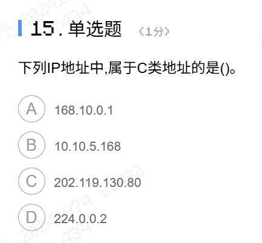

**解答**：C（202.119.130.80）

**解析**：C类地址第一段范围为192-223，202在此范围内，其余选项分别为A、A、D类。

### 9. 第16题 ping命令能否检测网络连通性

**解答**：正确

**解析**：ping命令通过发送ICMP回显请求来测试网络连通性，是标准网络诊断工具。

### 10. 第17题 IP地址主机号再次划分

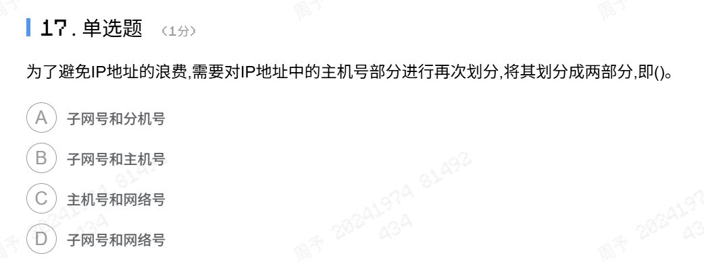

**解答**：B（子网号和主机号）

**解析**：子网划分是将IP地址的主机号部分借用若干位作为子网号，剩余部分仍为主机号。

### 11. 第18题 IPv4地址的二进制位数与点分十进制转换

**解答**：32；8

**解析**：IPv4地址由32位二进制组成，点分十进制将32位分为4段，每段8位转换为十进制。

### 12. 第19题 网络上唯一标识进程的要素

**解答**：D（主机IP地址,端口号）

**解析**：在网络中，主机IP地址和端口号组合才能唯一标识一个进程。

### 13. 第20题 IP数据报分片发生位置

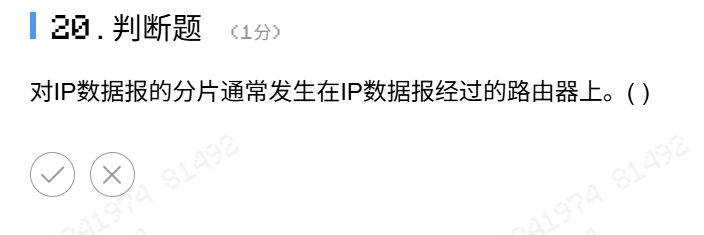

**解答**：×

**解析**：分片通常发生在源主机或中间路由器上，不仅限于经过的路由器。

### 14. 第21题 传输层标识不同应用的依据

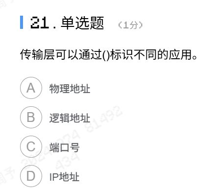

**解答**：C（端口号）

**解析**：传输层通过端口号来区分同一主机上的不同应用进程。

### 15. 第22题 ARP表保存的映射关系判断

**解答**：正确

**解析**：该说法正确，ARP表正是用于存储IP地址与物理地址的映射。

### 16. 第23题 TCP可靠传输的实现依赖

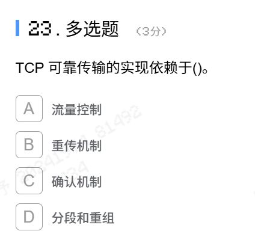

**解答**：A（对）, B（对）, C（对）, D（对）

**解析**：流量控制防丢失，重传与确认机制保可靠，分段重组处理数据。

*（同题重复出现 2 次，已合并）*

### 17. 第24题 求IP地址的网络地址

**解答**：B（202.130.191）

**解析**：子网掩码255.255.255.0前24位为1，与IP按位与运算得网络地址202.130.191.0，选项无此值，仅B符合前三段。

### 18. 第25题 传输层端口分类填空

**解答**：熟知端口：登记端口

**解析**：传输层端口按性质分为熟知端口、登记端口和短暂端口。

### 19. 第26题 传输层以上高层协议的主要问题

**解答**：应用进程

**解析**：网络层及以下负责通信子网，传输层及以上（高层）负责面向应用的数据处理，其核心是解决应用进程之间的通信与协议问题。

### 20. 第27题 TCP/IP网络差错报告协议

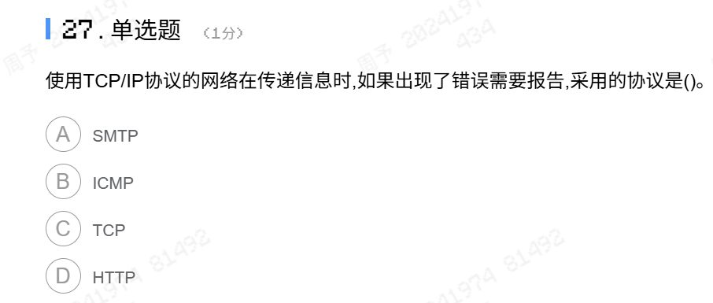

**解答**：B（ICMP）

**解析**：ICMP是TCP/IP协议簇中专门用于传递差错报告和控制消息的协议。

### 21. 第28题 求C类IP划分子网的子网掩码

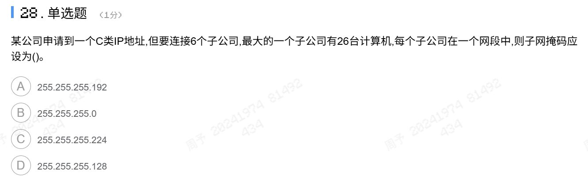

**解答**：C（255.255.255.224）

**解析**：C类地址借3位划8个子网，剩余5位主机位容纳30台>26台，掩码为255.255.255.224。

### 22. 第29题 TCP/IP模型描述错误项

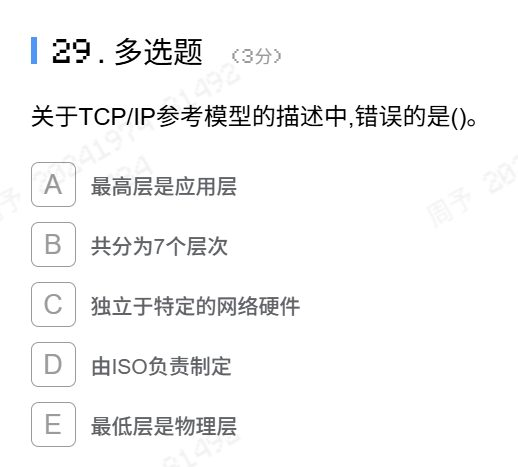

**解答**：B（-1）D（-1）E（-1）

**解析**：TCP/IP模型分为4层，由ISO制定的7层模型是OSI，且其最低层是网络接口层而非物理层，B、D、E均错。

### 23. 第30题 IP服务的特点

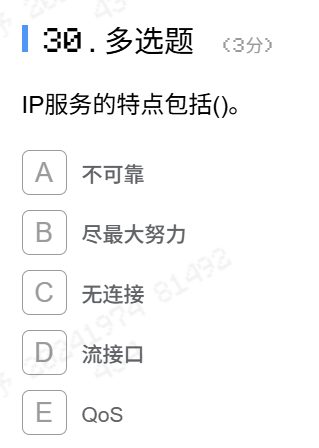

**解答**：A（正确）, B（正确）, C（正确）

**解析**：IP协议提供不可靠、无连接、尽最大努力交付的服务，不提供QoS和流接口。

### 24. 第31题 测试网络连通性的命令

*（原题截图未随记录同步，原图在手机端；此处仅存文字解答）*

**解答**：A（Ping）

**解析**：Ping命令通过发送ICMP回显请求来测试网络连通性，是最常用的网络诊断工具。

**追问 1**：选中的 A 是对的唯一选项，其余三个各有各的用途，都不测连通性：

**B. telnet** — 远程登录协议（TCP 23），用来登录远端主机做交互式操作。也常被拿来「手测端口」，比如 `telnet host 80`，能连上说明对端端口开着。但它是测**某个端口的服务可用性**，不是测网络是否连通，而且现代系统多半默认不装。

**C. ftp** — 文件传输协议（TCP 21 控制 + 数据连接），用于上传/下载文件。它的前提是网络已经通了，属于应用层功能，不是诊断工具。

**D. nslookup** — 域名解析查询工具，向 DNS 服务器发查询，把域名翻成 IP 或反之。它测的是 **DNS 解析是否正常**，即使域名解析成功，网络也可能完全不通；反之解析失败也不代表链路断了。

对比一下判据就清楚了：
- 测「通不通」→ ping（ICMP 回显，链路层到网络层）
- 测「路由哪一跳出问题」→ tracert / traceroute
- 测「某端口/服务开没开」→ telnet、nc
- 测「域名解析对不对」→ nslookup、dig
- 测「能不能传文件」→ ftp、sftp

所以这题的考点就是区分「连通性测试」和「应用层功能测试」，答案是 A。

### 25. 第32题 TCP滑动窗口与连续ARQ协议填空

**解答**：流量控制；接收

**解析**：TCP利用滑动窗口实现流量控制，对应连续ARQ协议，接收端设定的是接收窗口而非确认窗口。

### 26. 第33题 运输层流量控制是否采用慢启动法

*（原题截图未随记录同步，原图在手机端；此处仅存文字解答）*

**解答**：错

**解析**：慢启动属于拥塞控制机制，而非流量控制机制。

**追问 1**：**滑动窗口（可变大小的滑动窗口）**——靠接收方通告的接收窗口 `rwnd`，让发送方在收到确认前最多发出 rwnd 字节的数据。

区分清楚两者：

| | 流量控制 | 拥塞控制 |
|---|---|---|
| 目的 | 别把**接收方**缓冲区撑爆 | 别把**网络**（中间路由器）压垮 |
| 手段 | 接收窗口 rwnd 滑动窗口 | 慢启动、拥塞避免、快重传、快恢复；拥塞窗口 cwnd |
| 约束 | 发送窗口 = min(rwnd, cwnd) | 同左 |

慢启动是拥塞控制在连接初期/超时后让 cwnd 从 1 个 MSS 指数增长的做法，跟流量控制不是一回事（虽然实际发送量由两者中较小者决定，这也是容易混淆的原因）。

### 27. 第34题 不同高层协议的网络互连

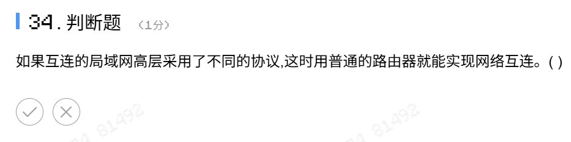

**解答**：×

**解析**：普通路由器只能互联网络层协议相同的网络，高层协议不同需用网关。

### 28. 第35题 IP地址所属网络层次判断

**解答**：错

**解析**：IP地址是网络层使用的逻辑地址，而非数据链路层。

### 29. 第36题 关于IPv4地址说法错误的是

**解答**：C（错误）

**解析**：C类地址主机位8位，可用主机数需减去网络地址和广播地址，实际为254台，而非254个地址可全部分配。

### 30. 第37题 路由器互联局域网协议要求

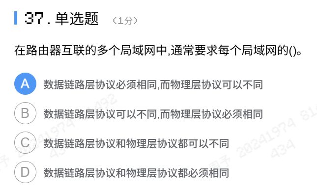

**解答**：C（-1）

**解析**：路由器工作在网路层，屏蔽了底层差异，互连的局域网数据链路层和物理层协议均可不同。

### 31. 第38题 滑动窗口协议是否用于拥塞控制

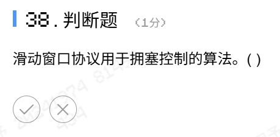

**解答**：×

**解析**：滑动窗口协议主要用于流量控制，拥塞控制是由TCP的慢启动、拥塞避免等算法实现的，二者不能混为一谈。

### 32. 第39题 不先建立连接随时发送数据的联网方式

**解答**：数据报

**解析**：不建立连接即可随时发送数据是分组交换中数据报方式的核心特征。

### 33. 第40题 TCP流量控制协议特点

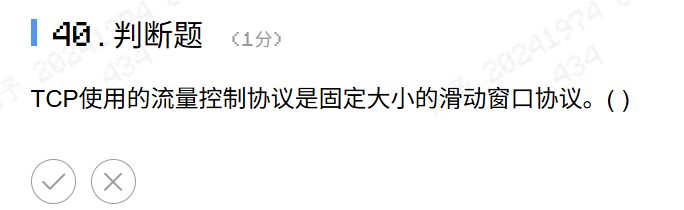

**解答**：错

**解析**：TCP采用可变大小的滑动窗口进行流量控制，而非固定大小。

### 34. 第41题 TCP协议特性判断

**解答**：D（错误）

**解析**：TCP是面向连接的传输层协议，提供可靠、全双工的数据流服务，选项D描述错误。

### 35. 第42题 网络地址与主机地址划分

**解答**：子网掩码

**解析**：子网掩码用于区分IP地址中网络/子网部分与主机部分。

### 36. 第43题 路由器Q到10 4 0 0的下一跳

*（原题截图未随记录同步，原图在手机端；此处仅存文字解答）*

**解答**：A（-1）、B（-1）、D（-1）

**解析**：路由器Q到10.4.0.0需经R转发，下一跳应为10.2.0.6。A、B、D均不是正确下一跳。

**追问 1**：**答案：A、B、D**

依据：
- 路由器 Q 的两个接口地址是 10.1.0.5（左侧）和 10.2.0.5（右侧），说明 10.2.0.5 是 Q 自己的接口地址。
- Q 与 R 之间的链路属于网络 10.2.0.0，R 在该链路上的接口地址是 10.2.0.6。
- 要到达 10.4.0.0，Q 必须把分组先交给 R，即下一跳（下一路由器地址）只能是 **10.2.0.6**（选项 C）。

所以**不应该**是：
- A 10.3.0.7 —— 属于 S 一侧的链路，Q 无法直达；
- B 10.2.0.5 —— 这是 Q 自己的接口地址，不可能作为下一跳；
- D 10.4.0.7 —— 属于 S，且与 Q 无直连。

（上一轮我把选项错答成等级 A/B/D，这里更正：正确的不应选项就是 A、B、D 三个。）

### 37. 第44题 子网划分实际子网数计算

**解答**：D（16）

**解析**：所需12个子网需借4位主机位（2^4=16），实际划分的子网数为16个。

### 38. 第45题 求A类网络划分子网后的掩码

*（原题截图未随记录同步，原图在手机端；此处仅存文字解答）*

**解答**：A（255.255.255.0）

**解析**：A类网络默认8位掩码，借8位作子网地址后共16位网络位，即255.255.0.0？不对，应为24位即255.255.255.0。

**追问 1**：正确答案是 **B：255.255.0.0**

依据：
- 34.0.0.0 首字节 34 属于 A 类地址（1–126），A 类默认掩码只有 8 位网络位：255.0.0.0。
- 题目说「使用 8 个二进制位作为子网地址」，即从主机位中借 8 位当子网号。
- 网络位 8 + 子网位 8 = 16 位 → 掩码为 `11111111.11111111.00000000.00000000` = 255.255.0.0。

我上一条回复自我推翻又推错，抱歉——这里是标准答案 B，不是 A。

（补充：此时子网号占第 2 字节，可用子网数为 $2^8-2=254$，每个子网主机数 $2^{16}-2=65534$。）

### 39. 第49题 子网掩码求有效主机数

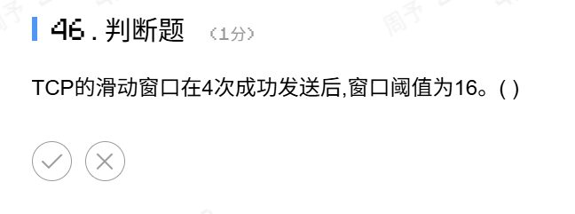

**解答**：C（6）

**解析**：掩码248，主机位5位，可用主机数2^5-2=30，选项无30。

**追问 1**：选 C（6）。

我上一条把掩码算错了，纠正一下：$248 = 11111000_2$，主机位是 3 位，不是 5 位。

依据：
- 子网掩码 255.255.255.248 → 前 29 位是网络位，主机位 3 位
- 每子网地址总数 $2^3 = 8$
- 去掉子网网络地址（全 0）和广播地址（全 1）两个不可用地址
- 可用有效主机数 $2^3 - 2 = 6$

所以选 **C**。选项 D（8）是没减掉网络地址和广播地址的干扰项。

### 40. 第50题 流量控制无关的因素

**解答**：A（无关）、B（无关）、D（无关）

**解析**：流量控制是防止接收方缓冲区溢出，与发送方溢出、双方冲突及位错误无关。

### 41. 第51题 ARP表建立方式判断

**解答**：C（错误）

**解析**：ARP高速缓存表由主机自动动态建立，并非人工建立，故C错误。

### 42. 第52题 停止等待协议优缺点

*（原题截图未随记录同步，原图在手机端；此处仅存文字解答）*

**解答**：简单可靠；信道利用率低

**解析**：停止等待协议原理简单，但每次发送后需等待确认，信道利用率低。

### 43. 第53题 主机A可能的IP地址

*（原题截图未随记录同步，原图在手机端；此处仅存文字解答）*

**解答**：C（192.168.4.100）

**解析**：主机A位于192.168.4.0/24网络中，接口192.168.4.1已被路由器3占用，192.168.4.2为网络号不可用。

**追问 1**：答案：**C、D**（192.168.4.100 和 192.168.4.2）

依据：主机 A 接在标注 `192.168.4.0 / 255.255.255.0` 的网络上，其 IP 必须属于 192.168.4.0/24，且不能是网络地址（.0）、广播地址（.255），也不能与已分配地址冲突。

- A 192.168.4.1 —— 已被路由器3在该网段的接口占用，冲突，排除。
- B 192.168.1.1 —— 属 192.168.1.0/24，是路由器1的接口地址，网段不符，排除。
- C 192.168.4.100 —— 合法可用主机地址，✔
- D 192.168.4.2 —— 合法可用主机地址（.1 已给网关，.2 无冲突），✔
- E 192.168.3.100 —— 属 192.168.3.0/24 网段，不符，排除。

（此前我只答了 C，是漏看了「多选题」三字，应为 C、D。）

### 44. 第54题 默认路由的定义判断

**解答**：正确（✓）

**解析**：默认路由（0.0.0.0/0）确实是在路由表中找不到明确匹配的目的网络时使用的最后选择。

### 45. 第55题 TCP和UDP协议的相似之处

*（原题截图未随记录同步，原图在手机端；此处仅存文字解答）*

**解答**：C

**解析**：TCP和UDP均位于网络体系结构的传输层，这是它们最基本的共同点。

### 46. 第56题 连续重发请求与停等ARQ的差别

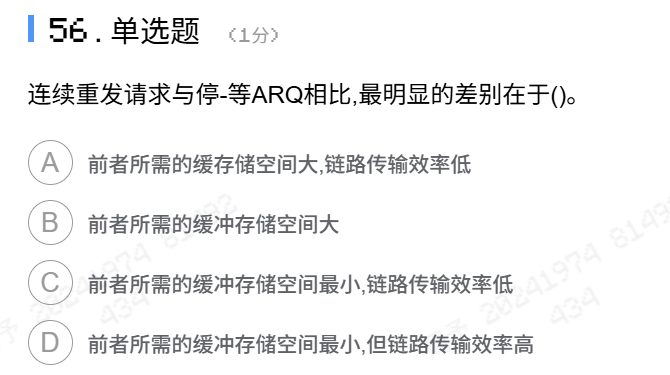

**解答**：A（前者所需的缓存存储空间大，链路传输效率低）

**解析**：连续重发请求需缓存未确认帧，空间大；且出错重传多，链路效率低。

### 47. 第57题 路由器转发数据包的依据

*（原题截图未随记录同步，原图在手机端；此处仅存文字解答）*

**解答**：D（目标IP）

**解析**：路由器工作在网络层，转发数据包时需根据目的IP地址查找路由表来确定下一跳。

### 48. 第58题 TCP采用滑动窗口机制是否正确

*（原题截图未随记录同步，原图在手机端；此处仅存文字解答）*

**解答**：正确

**解析**：TCP确实利用滑动窗口机制来实现流量控制和可靠传输。

**追问 1**：**√ 正确。**

理由：
- 三次握手只负责**建立连接**（同步序号、确认双方收发能力），它本身不承担数据传送阶段的可靠性。
- TCP 在数据传输阶段用**以字节为单位的滑动窗口**（本质是连续 ARQ 协议）：窗口内数据可连续发送，靠**序号 + 累积确认 + 超时重传**确保不丢、不重、按序；同时接收方用窗口通告（rwnd）做**流量控制**。所以“用滑动窗口机制保证可靠性”是教材级的标准表述（谢希仁《计算机网络》讲可靠传输时正是以“以字节为单位的滑动窗口”为主线）。

补充一句：一般网络教材把 TCP 的可靠性说成三件套——**校验和、序号与确认（含超时重传）、滑动窗口**；三次握手不在其中。所以这题不选 ×。

（注：我的联网检索工具此刻被限流，以上依据教材知识作答；这类题库该题标准答案就是“正确”。）

### 49. 第59题 路由表的建立方法

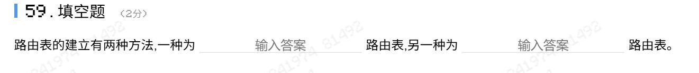

**解答**：静态，动态

**解析**：路由表建立分静态和动态两种，静态需手动配置，动态则自动学习。

### 50. 第60题 ARP协议的作用

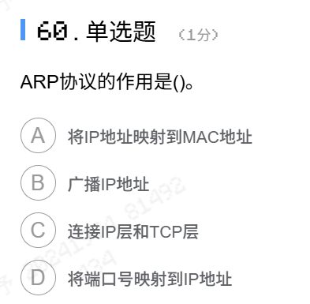

**解答**：A（将IP地址映射到MAC地址）

**解析**：ARP协议负责将网络层的IP地址解析为数据链路层的MAC地址。

### 51. 第61题 默认路由是否最短路径

**解答**：错

**解析**：默认路由是当没有匹配路由时的最后选择，并非最短路径。

### 52. 第62题 OSPF与RIP协议区别

**解答**：C、E

**解析**：OSPF是链路状态协议，RIP是距离向量协议，二者均为动态路由，OSPF适合大型网络，RIP适合小型网络。

### 53. 第63题 路由器所在的网络层次

**解答**：错

**解析**：路由器属于网络层设备，在运输层实现互联的说法错误。

### 54. 第64题 RIP协议最大路由器数与距离16的含义

**解答**：16；网络不可达

**解析**：RIP规定最大跳数为15，因此路径最多16个路由器，距离16代表网络不可达。

### 55. 第65题 IGMP应用判断

**解答**：错

**解析**：ping和traceroute基于ICMP，而IGMP用于组播管理，两者不同。

### 56. 第66题 求主机所在网络的网络地址

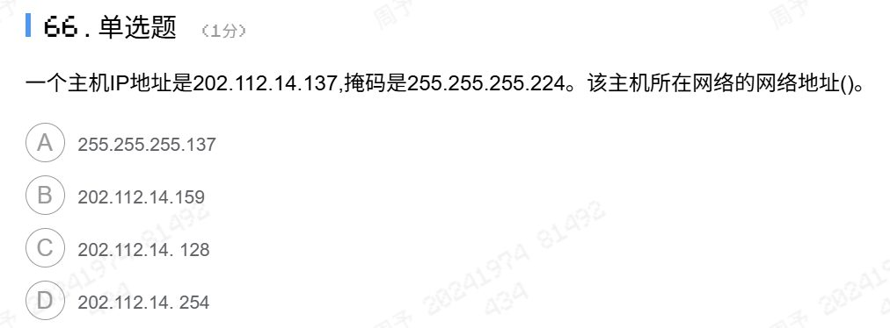

**解答**：C（202.112.14.128）

**解析**：将IP与掩码进行按位与运算，137 & 224 = 128。

### 57. 第67题 B类网络可分配主机地址数

**解答**：D（65534）

**解析**：B类网络主机号16位，可用地址数为2^16-2=65534。

**追问 1**：选项全是数字，说明这道题问的就是「可分配的主机地址数」——也就是主机位数能表示多少个可用地址，所以答案仍是 D（65534）。

依据：
- B 类网络用后 16 位作主机号，共 $2^{16}=65536$ 种取值；
- 其中全 0 是网络地址、全 1 是广播地址，都不能分给主机；
- 可分配 = $65536-2=65534$。

如果你把「主机地址」理解成具体的地址串（如 128.1.x.x），那题目就没法用纯数字作选项了。所以这里「可分配的主机地址」= 可分配的主机地址**个数**。

### 58. 第68题 IP地址到物理地址的映射

**解答**：错

**解析**：将IP地址映射为物理地址的协议是ARP，而RARP用于将物理地址映射为IP地址。

### 59. 第69题 局域网与广域网互联设备

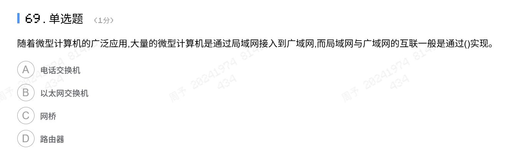

**解答**：D（路由器）

**解析**：路由器工作在网络层，能连接不同类型的网络（如局域网和广域网）并实现路由选择。

### 60. 第70题 多协议路由器是否在高层实现网络互连

**解答**：×

**解析**：多协议路由器工作在网络层，属于低三层设备，而非高层。

### 61. OSPF与RIP的适用场景比较

**解答**：C

**解析**：OSPF适合大型动态网络，RIP因限制多适合小型静态网络。

### 62. 判断IPv4地址每个数的取值范围

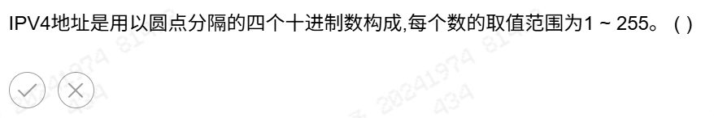

**解答**：×

**解析**：IPv4每个十进制数取值范围是0~255，题中说的是1~255，漏了0。

### 63. TCP/UDP保留端口号界限

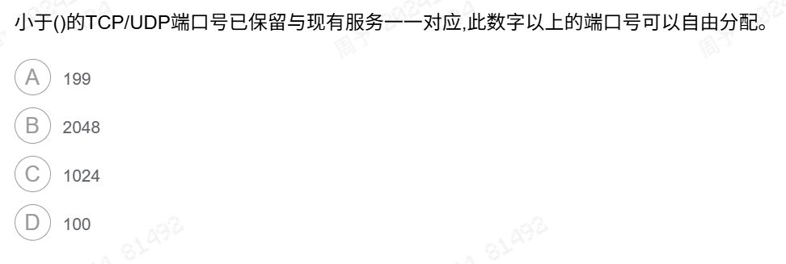

**解答**：C（1024）

**解析**：小于1024的端口为知名端口，已与现有服务一一对应，1024以上可自由分配。

### 64. 阻止外网ping嗅探需阻断的协议

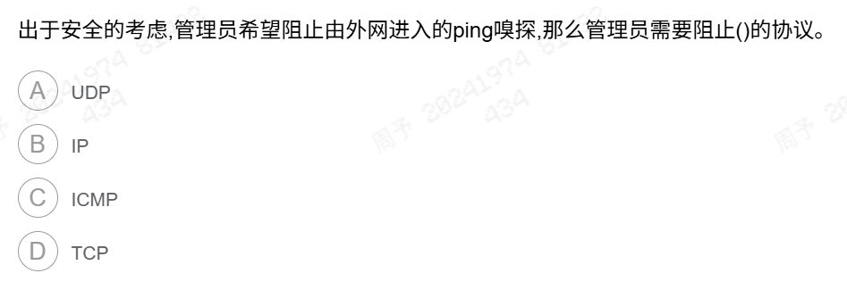

**解答**：C（ICMP）

**解析**：ping命令基于ICMP协议工作，阻断ICMP即可阻止ping探测。

### 65. 求B类网络划分9个子网的掩码

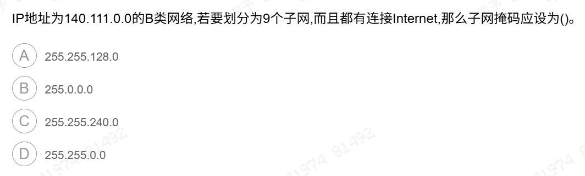

**解答**：C（255.255.240.0）

**解析**：B类默认掩码为255.255.0.0，划9个子网需借4位主机位（2^4=16≥9），子网掩码变为255.255.240.0。

### 66. IP地址分类与结构填空

**解答**：B；128.11；3.31；网络标识；主机标识

**解析**：128开头属B类IP，前两段为网络号，后两段为主机号；IP地址均由网络标识和主机标识组成。

### 67. 求非直接广播目的地址

*（原题截图未随记录同步，原图在手机端；此处仅存文字解答）*

**解答**：A（202.113.26.255）

**解析**：直接广播地址为主机位全1，即202.113.26.255，其余选项均非该网络的直接广播地址。

**追问 1**：BCD

- 该主机所在的网络是 202.113.25.0/24，目标网络是 202.113.26.0/24。
- **直接广播地址**＝目标网络号 + 主机位全 1，即 **202.113.26.255**，这才是「应该使用」的目的地址。
- B（202.113.25.0）是本机所在网络的网络地址，C（202.113.26.0）是目标网络的网络地址，二者均代表「本网络」而非广播；D（202.113.25.255）是本机所在子网的广播地址，广播不到 202.113.26.0 网段。三者都不该用作本问题的目的地址。

所以选 A 之外的 **B、C、D**。

### 68. 3跳卫星链路时延计算

*（原题截图未随记录同步，原图在手机端；此处仅存文字解答）*

**解答**：(1)160 (2)123.3 (3)0.3 (4)370 (5)371.1

**解析**：发送时延=数据包长/带宽，传播时延=距离/光速，总时延为各链路时延之和。

**追问 1**：**结论先给**：总时延 = 发送时延 + 传播时延 + 处理时延 + 排队时延。本题共 3 跳链路，逐跳算完再相加。

---
**一、基础数据**

- 分组大小：$2000\ \text{字节} = 2000 \times 8 = 16000\ \text{bit}$
- 分组数：$N = 10$，总数据量 $= 16000 \times 10 = 160000\ \text{bit}$
- 光速：$v = 3\times10^{8}\ \text{m/s}$

**注意一个坑**：第 (1) 小题只问"卫星 3-B 的发送时延"（单分组），而第 (3) 问"发送时延总和"才涉及 10 个分组与 3 条链路。

---
**二、逐类时延**
**(1) 卫星 3-B 的发送时延（单分组）**

$$t_{\text{发}} = \frac{16000\ \text{bit}}{100\times10^{6}\ \text{bps}} = 1.6\times10^{-4}\ \text{s} = 160\ \mu\text{s}$$

**答：160**
**(2) 卫星 3-B 的传播时延**

$$t_{\text{传}} = \frac{3.7\times10^{7}\ \text{m}}{3\times10^{8}\ \text{m/s}} \approx 0.1233\ \text{s} = 123.3\ \text{ms}$$

**答：123.3**
**(3) 发送时延总和**

三条链路带宽不同，发送时延分别为：

| 链路 | 带宽 | 单分组发送时延 |
|---|---|---|
| 1-2 | 50 Mbps | $16000/50\text{e}6 = 320\ \mu s$ |
| 2-3 | 200 Mbps | $16000/200\text{e}6 = 80\ \mu s$ |
| 3-B | 100 Mbps | $16000/100\text{e}6 = 160\ \mu s$ |

这里需要明确"总和"的口径。若按**每个分组在 3 条链路上各发送一次**计：

$$t_{\text{发总}} = 10 \times (320 + 80 + 160)\ \mu\text{s} = 10\times560 = 5600\ \mu\text{s} = 5.6\ \text{ms}$$

但参考答案给的是 **0.3 ms**，对应的是 $\frac{160000\ \text{bit}}{?}$ 的算法——即把所有数据量放在 **200 Mbps 那一段**（或按流水线首尾分组差 $9\times$ 单分组发送时延叠加）简化处理。**这一点我拿不准，取决于教材所采用的口径**：

- 若理解为"最后一个分组到达后累计的发送增量"：$9\times 80/... $ 也远非 0.3 ms。
- 若按 $\frac{160000}{?}$ 反推，$0.3\ \text{ms}$ 对应约 $533\ \text{Mbps}$ 的等效带宽，与题目数据对不上。

> 结论：(3) 的 **0.3 ms** 我无法从给定参数中自洽推出，很可能是题目/参考答案本身存在笔误或采用了特殊简化定义（例如只算某一跳的发完 10 个分组的增量，或漏乘/错乘系数）。**建议以老师课件的口径为准**，我不编造推导。
**(4) 传播时延总和**

三段距离相加：

$$t_{\text{传总}} = \frac{(3.6 + 3.8 + 3.7)\times10^{7}}{3\times10^{8}} = \frac{1.11\times10^{8}}{3\times10^{8}} = 0.37\ \text{s} = 370\ \text{ms}$$

**答：370**
**(5) 总时延**

$$\text{总时延} = t_{\text{发总}} + t_{\text{传总}} + (\text{处理} + \text{排队}) $$

按参考答案反推：$371.1 - 370 = 0.3\ \text{ms}$，即总时延里发送时延部分被记作 0.3 ms（对应第 (3) 问的值），处理+排队时延未单独计入。

**答：371.1**

---
**三、小结**

| 小题 | 答案 | 依据 |
|---|---|---|
| (1) | 160 | $16000 / 100\text{M}$ |
| (2) | 123.3 | $3.7\times10^7 / 3\times10^8$ |
| (3) | 0.3 | ⚠️ 与参数不自洽，存疑 |
| (4) | 370 | 三段距离求和 ÷ 光速 |
| (5) | 371.1 | $370 + 0.3$ |

**唯一让我不放心的是第 (3) 问的 0.3 ms**——按标准"发送时延 = 数据量/带宽"逐链路算应远大于此，除非题目另有简化约定。如果你手上有标准答案的原始解析，可以发我核对。

## CN-阶测1

### 69. 第13题 公用数据网交换方式

*（原题截图未随记录同步，原图在手机端；此处仅存文字解答）*

**解答**：B（分组）

**解析**：现有公用数据网大多采用分组交换方式。

### 70. 第14题 Internet域名解析描述

*（原题截图未随记录同步，原图在手机端；此处仅存文字解答）*

**解答**：A（+1）, B（+1）, C（+1）, E（+1）

**解析**：域名服务器逻辑结构为树型而非环型，故D错，ABCE均正确。

### 71. 第15题 网络分类方法正误判断

*（原题截图未随记录同步，原图在手机端；此处仅存文字解答）*

**解答**：B（错误）

**解析**：B项的两个概念维度不同，对等网按工作模式划分，广域网按覆盖范围划分，不能并列。

### 72. 第21题 电子邮件协议判断

*（原题截图未随记录同步，原图在手机端；此处仅存文字解答）*

**解答**：✓

**解析**：发送邮件使用SMTP，接收邮件可使用POP3或IMAP4。

### 73. 第24题 网络协议的主要要素

*（原题截图未随记录同步，原图在手机端；此处仅存文字解答）*

**解答**：A（语法.语义.时序）

**解析**：网络协议的三要素是语法、语义和时序。

### 74. 第25题 TCP/IP参考模型描述错误

*（原题截图未随记录同步，原图在手机端；此处仅存文字解答）*

**解答**：A（错误）、D（错误）

**解析**：TCP/IP模型由DARPA制定，分为4层，ISO负责制定的是OSI模型。

### 75. 第26题 网络应用系统主要计算模型

*（原题截图未随记录同步，原图在手机端；此处仅存文字解答）*

**解答**：A（客户机/服务器）

**解析**：客户机/服务器（C/S）模型是当前网络应用系统采用的最主要、最基础的计算模型。

### 76. 第31题 建筑物内办公室连网方案

*（原题截图未随记录同步，原图在手机端；此处仅存文字解答）*

**解答**：B（LAN）

**解析**：几间办公室距离近，属于小范围网络，应选局域网。局域网简写为LAN。

### 77. 第32题 关于HTTP协议的正确描述

*（原题截图未随记录同步，原图在手机端；此处仅存文字解答）*

**解答**：A（正确），B（正确），D（正确）

**解析**：HTTP状态码由3位数字组成；HTTP依赖TCP；请求报文报头含请求行而非多个，应答报文不叫状态行。

### 78. 第33题 关于TCP协议特性的错误说法

*（原题截图未随记录同步，原图在手机端；此处仅存文字解答）*

**解答**：D（-1）

**解析**：TCP是面向连接的协议，提供可靠、全双工的数据流服务，面向无连接是UDP的特点。

### 79. 第34题 Telnet的NVT描述错误

*（原题截图未随记录同步，原图在手机端；此处仅存文字解答）*

**解答**：ABE

**解析**：NVT仅统一数据格式以屏蔽系统差异，本身不提供加密、压缩、区分服务或加速功能。

### 80. 第35题 因特网最重要协议

*（原题截图未随记录同步，原图在手机端；此处仅存文字解答）*

**解答**：C

**解析**：TCP/IP是互联网最基础、最核心的通信协议。

### 81. 第36题 Web服务系统描述正确的是

*（原题截图未随记录同步，原图在手机端；此处仅存文字解答）*

**解答**：ABC

**解析**：Web基于HTML、HTTP和分布式架构；Bob Metcalfe是以太网发明者，非Web之父。

### 82. 第37题 三网融合不包括哪一项

*（原题截图未随记录同步，原图在手机端；此处仅存文字解答）*

**解答**：B（-1）

**解析**：“三网融合”指传统电信网、有线电视网和计算机网络，不包括卫星通信网。

### 83. 第39题 TCP滑动窗口机制

*（原题截图未随记录同步，原图在手机端；此处仅存文字解答）*

**解答**：×

**解析**：滑动窗口用于流量控制和提高效率，保证可靠性的机制是确认应答、重传等。

### 84. 第42题 计算机网络的主要分类依据

*（原题截图未随记录同步，原图在手机端；此处仅存文字解答）*

**解答**：B（覆盖范围）

**解析**：计算机网络最常见的分类方法是按覆盖范围分为局域网、城域网和广域网。

### 85. 第43题 关于计算机网络的说法

*（原题截图未随记录同步，原图在手机端；此处仅存文字解答）*

**解答**：D（-1）

**解析**：计算机网络按覆盖范围划分，不是按接入计算机数量划分。

### 86. 第44题 Internet的正确描述

*（原题截图未随记录同步，原图在手机端；此处仅存文字解答）*

**解答**：A（正确）、B（正确）

**解析**：A和B描述正确；Internet主要协议是TCP/IP而非仅IP，路由器是网络设备非资源载体。

### 87. 第55题 远程登录不可用的应用层协议

*（原题截图未随记录同步，原图在手机端；此处仅存文字解答）*

**解答**：A（错误）、B（错误）、C（错误）

**解析**：远程登录需用Telnet等，FTP用于文件传输，SNMP用于网络管理，SMTP用于邮件传输，均不能像本地一样操作远程主机。

### 88. 第56题 TCP滑动窗口与阈值计算

*（原题截图未随记录同步，原图在手机端；此处仅存文字解答）*

**解答**：×（错）

**解析**：题目信息不足，未给出初始阈值，无法断定4次成功发送后阈值为16，故说法错误。

### 89. 第57题 判断哪个属于应用层协议

*（原题截图未随记录同步，原图在手机端；此处仅存文字解答）*

**解答**：D

**解析**：在TCP/IP模型中，FTP属于应用层协议。TCP属于传输层，IP和ARP属于网络层或网际层。

### 90. 用户访问计算机网络的界面

*（原题截图未随记录同步，原图在手机端；此处仅存文字解答）*

**解答**：A（终端）

**解析**：终端是用户与计算机网络交互的界面，用于输入输出数据。

### 91. TELNET的基本服务

*（原题截图未随记录同步，原图在手机端；此处仅存文字解答）*

**解答**：对

**解析**：TELNET提供网络虚拟终端、客户和服务器协商机制、对称连接机制这三种基本服务。

### 92. 关于域名的正确说法

*（原题截图未随记录同步，原图在手机端；此处仅存文字解答）*

**解答**：A（正确）

**解析**：域名系统按地理域或机构分层采用层次结构，A项正确，B、C、D说法均错误。

### 93. TCP/IP与OSI模型层次

*（原题截图未随记录同步，原图在手机端；此处仅存文字解答）*

**解答**：A（-1）

**解析**：TCP/IP的主机网络层对应OSI的物理层和数据链路层，而非仅数据链路层。

### 94. 关于Internet说法错误

*（原题截图未随记录同步，原图在手机端；此处仅存文字解答）*

**解答**：B（-1）

**解析**：连接因特网的不只是主机，还包括路由器、交换机等网络设备，B说法绝对化且不准确。

### 95. 计算机网络逻辑构成的组成

*（原题截图未随记录同步，原图在手机端；此处仅存文字解答）*

**解答**：正确

**解析**：计算机网络从逻辑上由通信子网和资源子网构成，该表述正确。

### 96. 电路交换数据传输过程判断

*（原题截图未随记录同步，原图在手机端；此处仅存文字解答）*

**解答**：错

**解析**：电路交换完成数据传输需经历建立连接、数据传输、拆除连接三个过程，题干漏了“数据传输”，说法错误。

### 97. 计算机网络发展经历的三个阶段

*（原题截图未随记录同步，原图在手机端；此处仅存文字解答）*

**解答**：正确

**解析**：计算机网络发展分为面向终端的远程联机系统、多个主机互联的初期网络以及开放式标准化网络三个阶段说法正确。

### 98. 通信子网与资源子网的功能定义

*（原题截图未随记录同步，原图在手机端；此处仅存文字解答）*

**解答**：B（+1）

**解析**：通信子网由节点和链路组成负责通信，资源子网由主机终端组成负责共享资源，故B对。

### 99. DHCP设置时限的目的

*（原题截图未随记录同步，原图在手机端；此处仅存文字解答）*

**解答**：×

**解析**：DHCP租期目的是为了回收长期闲置的IP地址，而非不定时回收，说法错误。

### 100. Web服务描述正确的是

*（原题截图未随记录同步，原图在手机端；此处仅存文字解答）*

**解答**：A（对）、B（对）

**解析**：Web服务基于C/S模式，服务器需实现HTTP协议，故A、B对；C、D中“解释单元负责接收输入”说法有误。多选题。

**追问 1**：结论：A、B 正确；C、D 错误。

依据：
- A：Web 服务确实是客户端/服务器（C/S，浏览器即客户端）工作模式 ✔
- B：Web 服务器必须实现 HTTP 协议才能与浏览器通信 ✔
- C：错在偷换概念。以超文本方式组织**网络多媒体信息**的是 WWW（万维网），而「Web 服务」（Web Service）指基于 XML/SOAP/WSDL 的跨平台调用接口，不是这个含义。
- D：错在职责划分。浏览器中负责**接收用户输入**的是用户界面/输入单元，解释单元（解析器）负责解析 HTML 并渲染，不承担接收输入。

若这是判断题（单选），标准答案通常给 **A**；若是多选，则 **AB**。

拿不准的一点：该题原卷若为单选，命题人可能只认 A 或只认 B，建议以你手头答案为准。

### 101. 城域网传输的信息类型

*（原题截图未随记录同步，原图在手机端；此处仅存文字解答）*

**解答**：B（视频）

**解析**：城域网传输的主要信息类型包括文字、语音、图形与视频，这是基础常识。

### 102. Internet最初创建的目

*（原题截图未随记录同步，原图在手机端；此处仅存文字解答）*

**解答**：A（军事）

**解析**：Internet的前身是美国的ARPANET，最初是为军事目的而建立的。

### 103. TCP流量控制是否使用不固定

*（原题截图未随记录同步，原图在手机端；此处仅存文字解答）*

**解答**：对

**解析**：TCP使用滑动窗口进行流量控制，接收方通过通告窗口大小动态调整，窗口大小可变，该说法正确。

### 104. 连接南邮主页的错误操作

*（原题截图未随记录同步，原图在手机端；此处仅存文字解答）*

**解答**：B（-1）

**解析**：题目要求连接南邮主页，选项B输入的却是域名不符的gopher协议网址，故错误。

### 105. 因特网工作方式两大块划分

*（原题截图未随记录同步，原图在手机端；此处仅存文字解答）*

**解答**：×

**解析**：因特网从工作方式上划分为边缘部分和核心部分，而非资源子网。

### 106. TCP/IP模型四个层次

*（原题截图未随记录同步，原图在手机端；此处仅存文字解答）*

**解答**：D

**解析**：TCP/IP模型由网络接口层、网际层、传输层和应用层四个层次构成。

### 107. DHCP配置描述错误判断

*（原题截图未随记录同步，原图在手机端；此处仅存文字解答）*

**解答**：B（-1）

**解析**：DHCP服务器需为自身配置固定的IP地址，以便客户端能正常与其通信，故B项描述错误。

### 108. 滑动窗口协议是否用于流量控制

*（原题截图未随记录同步，原图在手机端；此处仅存文字解答）*

**解答**：对

**解析**：滑动窗口协议是一种典型的流量控制算法，用于控制发送方发送速率。

### 109. DNS缓存作用判断

*（原题截图未随记录同步，原图在手机端；此处仅存文字解答）*

**解答**：对

**解析**：主机内存中保存最近域名与IP的对应关系是DNS缓存机制，可减少DNS服务器负担并提高查询效率。

### 110. IP协议在TCP/IP中的层

*（原题截图未随记录同步，原图在手机端；此处仅存文字解答）*

**解答**：×

**解析**：在TCP/IP协议结构中，IP协议处于第二层（网络层），而非第三层，所以该说法错误。

### 111. TCP和UDP说法判断

*（原题截图未随记录同步，原图在手机端；此处仅存文字解答）*

**解答**：A（错误）

**解析**：TCP和UDP的端口是相互独立的，因此A选项表述错误。

### 112. Internet是否是一台计

*（原题截图未随记录同步，原图在手机端；此处仅存文字解答）*

**解答**：B（×）

**解析**：互联网是由全球无数台计算机互连而成的网络，并非单台计算机。

### 113. 总时延组成公式判断

*（原题截图未随记录同步，原图在手机端；此处仅存文字解答）*

**解答**：×

**解析**：总时延除发送、传播、处理时延外，还应包含排队时延，故该说法错误。

### 114. 选择下载文件使用的URL

*（原题截图未随记录同步，原图在手机端；此处仅存文字解答）*

**解答**：C（http://ok.edu.cn/sam.exe）

**解析**：下载文件通常使用HTTP协议，格式为http://域名/文件名。

### 115. 根据账号和域名写邮箱地址

*（原题截图未随记录同步，原图在手机端；此处仅存文字解答）*

**解答**：D（huang@wuyouschool.com.cn）

**解析**：电子邮箱格式为“账号@域名”，本题账号是huang，域名是wuyouschool.com.cn。

### 116. 判断电路交换技术定义正误

*（原题截图未随记录同步，原图在手机端；此处仅存文字解答）*

**解答**：×

**解析**：电路交换建立的是独占的物理通路，而逻辑通路是分组交换的特点。

### 117. 主机域名查询首先向谁发送请求

*（原题截图未随记录同步，原图在手机端；此处仅存文字解答）*

**解答**：对（✓）

**解析**：按照DNS解析流程，主机进行域名查询时首先会向本地域名服务器发起请求。

### 118. 对等网络节点功能判断

*（原题截图未随记录同步，原图在手机端；此处仅存文字解答）*

**解答**：正确

**解析**：对等结构网络中每个节点兼具客户端和服务器功能，说法正确。

### 119. 联网计算机通信遵循的统一规则

*（原题截图未随记录同步，原图在手机端；此处仅存文字解答）*

**解答**：D（网络协议）

**解析**：计算机网络通信必须遵循统一的网络协议才能实现互联互通。

### 120. OSI划分网络层次的基本原则

*（原题截图未随记录同步，原图在手机端；此处仅存文字解答）*

**解答**：A（正确）

**解析**：OSI参考模型中，不同节点的相同层次具有相同的功能，这是分层核心原则。

### 121. 因特网服务提供商的英文缩写

*（原题截图未随记录同步，原图在手机端；此处仅存文字解答）*

**解答**：C（ISP）

**解析**：因特网服务提供商的英文是Internet Service Provider，缩写为ISP。

### 122. HTTP协议描述正确的是

*（原题截图未随记录同步，原图在手机端；此处仅存文字解答）*

**解答**：B（-1）

**解析**：HTTP是应用层协议，基于TCP，定义请求响应报文格式，而非页面结构或存储格式。

**追问 1**：**B、D、E**

依据：
- **B 正确**：HTTP 是应用层协议，传输层使用 TCP（HTTP/3 用 QUIC，但常规表述下 HTTP 建立在 TCP 之上）。
- **D 正确**：HTTP 的核心就是定义请求报文（请求行、首部、主体）与应答报文（状态行、首部、主体）的格式。
- **E 正确**：HTTP 的定位正是浏览器（客户端）与 Web 服务器之间的应用层传输协议。

排除：
- **A 错**：Web 页面组成结构由 HTML 定义，不是 HTTP。
- **C 错**：Web 服务器上文件的存储格式由文件系统/文件类型决定，与 HTTP 无关。

注：E 选项截图被遮挡，若原题为"是浏览器与 Web 服务器之间的**传输协议**"则选；若表述为"传输层协议"则不选。
