# 软件测试

> Spore 搜题记录汇总 · 共 **24** 题（有截图 24 题）· 时间 2026-10-27 ~ 2026-11-03
> 来源：Spore-MV3 24 题 · 导出 2026-11-21

分卷：黑盒测试（14 题）、白盒测试（10 题）

## 黑盒测试

### 1. 第4题 等价类划分原则

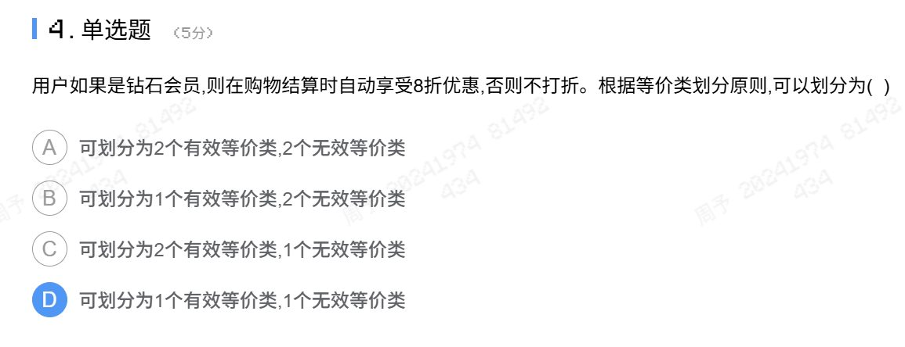

**解答**：D

**解析**：条件为钻石会员和非钻石会员，对应1个有效等价类和1个无效等价类。

### 2. 第5题 因果图法主要用途 ⭐

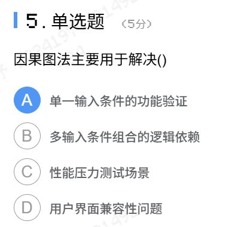

**解答**：B（多输入条件组合的逻辑依赖）

**解析**：因果图法通过分析输入条件间的组合与逻辑关系来设计测试用例。

### 3. 第6题 因果图恒等约束含义

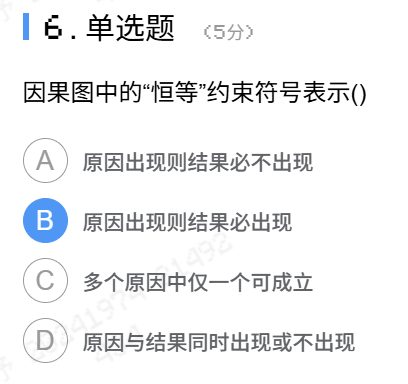

**解答**：B（原因出现则结果必出现）

**解析**：恒等约束表示原因出现则结果必出现，B项符合该定义。

### 4. 第8题 等价类划分中的有效等价类

**解答**：B（年龄=25）

**解析**：年龄25在18-60岁系统要求范围内，属于有效等价类。

### 5. 第9题 黑盒测试无法检测的问题

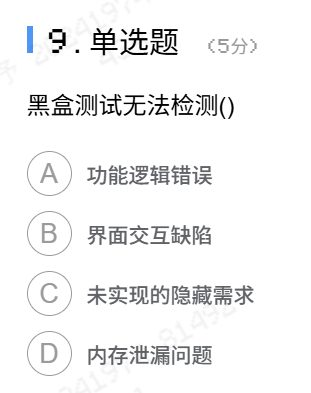

**解答**：D（内存泄漏问题）

**解析**：黑盒测试关注输入输出和功能，不关心内部代码结构，因此无法检测内存泄漏等内部实现问题。

### 6. 第10题 黑盒测试主要关注点

**解答**：B（输入与输出之间的功能是否符合规格）

**解析**：黑盒测试不关心内部结构，只看输入输出功能是否符合需求规格。

### 7. 第12题 等价类划分定义判断

**解答**：A（对）

**解析**：等价类划分确实是将输入域划分为若干子集，同一子集中的输入值在测试中被视为等效。

### 8. 第14题 边界值分析测试范围

**解答**：A（对）

**解析**：边界值分析就是专门针对输入范围的边界及其附近的值设计测试用例的方法，说法正确。

### 9. 第16题 布尔值等价类划分

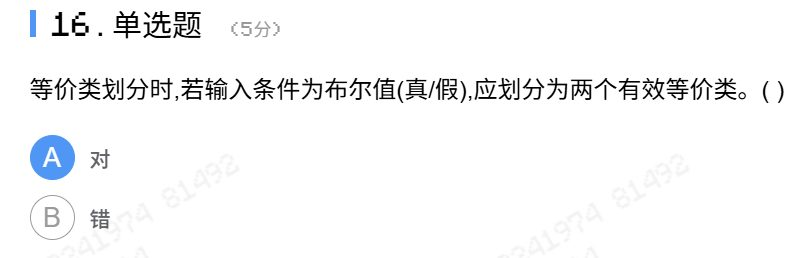

**解答**：A（对）

**解析**：布尔值仅有真、假两个取值，对应两个有效等价类，说法正确。

### 10. 第17题 连续数值范围的有效等价类划分 ⭐

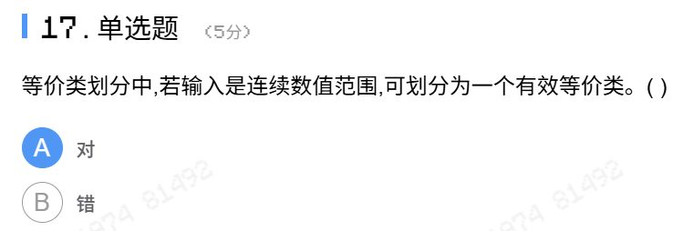

**解答**：B（错）

**解析**：连续数值范围通常需按有效、无效及边界划分，不能仅划为一个有效等价类。

### 11. 第18题 黑盒测试能否发现逻辑错误 ⭐

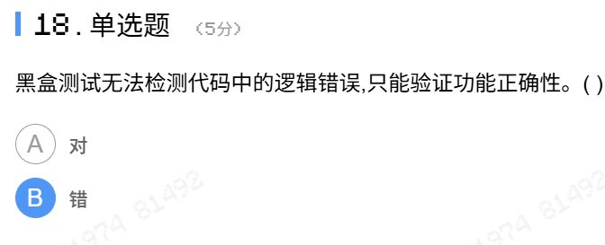

**解答**：B（错）

**解析**：黑盒测试只关注输入输出，但若逻辑错误导致输出异常，仍可被发现，故该说法错误。

### 12. 第19题 等价类划分与边界值分析结合的

**解答**：A（对）

**解析**：等价类划分和边界值分析结合使用，确实能有效减少测试用例数量，同时提高缺陷发现率。

### 13. 边界值分析测试取值 ⭐

**解答**：C（M=2,M=9）

**解析**：边界值分析需取边界上的点及边界外的邻近点：1<M<10的边界内点为2、9，边界外点为1、10。

**追问 1**：**不需要。这题问的是「边界值分析」（BVA），域外点是「健壮性测试」才取的。**

两类分开看：

| 方法 | 取点规则 | 对 $1<M<10$ |
|---|---|---|
| 边界值分析（正常值、单缺陷） | 只在有效域内取最近的边界值 | $2,\ 9$，即 C |
| 健壮性测试（Robustness） | 再补有效域外的邻近值 | $1,\ 2,\ 9,\ 10$ |

依据与细节：

- 题干是开区间，1 和 10 本身就不属于 M 的取值域，取值域里最近的边界值是 2 和 9。所以 A（1,10）是把「不等号端点」误当成边界值，B 的 0、11 连邻近值都不是（那是闭区间 $[1,10]$ 做健壮性测试才是 $0,1,10,11$），D 更是错位。
- 按国内教材「上点、内点、离点」三分法结论一致：上点 1 和 10 落在定义域外 → 离点位置向内移，取 2 和 9；再另配一个内点（如 5、6）。这一套只覆盖有效值，域外仍未涉及。
- 外点（1、10）的用途是验证「非法数据是否被拒绝」，属于健壮性测试，或等价类中的无效等价类，不是本题考点。

一点提醒：个别题库会把 A 当答案，那是命题人把「不等号写着的数字」当成边界值了，与 Myers / BS 7925-2 的经典定义不符。考试按主流答案选 **C**。

### 14. 用户名长度边界值测试用例选择 ⭐

**解答**：C

**解析**：边界值法需取边界点及刚越界的点。长度要求6-10位，对应边界应为6、10和5、11，选项C分别覆盖了abcde(5)、abcdef(6)、abcdefghij(10)、abcdefghijk(11)。

## 白盒测试

### 15. 第4题 条件覆盖与判定覆盖的区别

**解答**：B（条件覆盖关注每个原子条件的真/假,判定覆盖关注整体判定结果）

**解析**：条件覆盖关注每个原子条件的真假，判定覆盖只关注整体判定结果

### 16. 第5题 基本路径测试法的目标

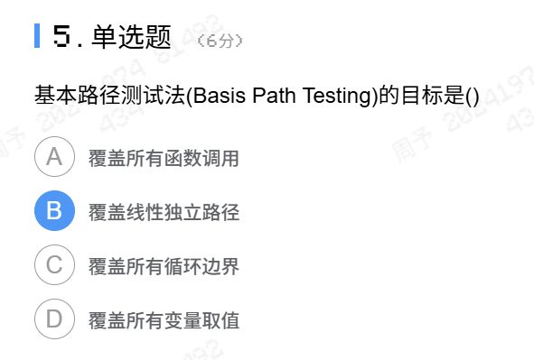

**解答**：B（覆盖线性独立路径）

**解析**：基本路径测试法旨在确保程序中每条线性独立路径至少被执行一次。

### 17. 第6题 适合白盒测试的场景

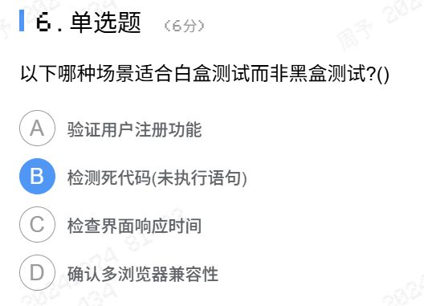

**解答**：B（检测死代码）

**解析**：白盒测试关注内部代码逻辑，检测死代码需查看代码执行路径，黑盒测试仅关注输入输出。

### 18. 第8题 判定覆盖测试用例选择

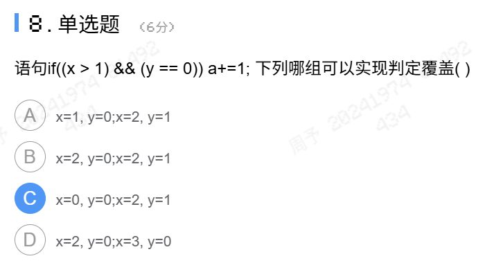

**解答**：C（x=0, y=0; x=2, y=1）

**解析**：判定覆盖需让判定条件取真和假各一次。选项C的x=0使判定为假，x=2, y=1使判定为真，满足要求。

### 19. 第9题 条件覆盖测试用例选择

**解答**：C（x=3,y=-2,k=-1;x=0,y=1,k=-3）

**解析**：条件覆盖需每个基本条件真假各一次，C选项使x>1为真/假、y<0为真/假、(x+k)>0为真/假各一次。

### 20. 第10题 简化程序流程图为控制流图的测 ⭐

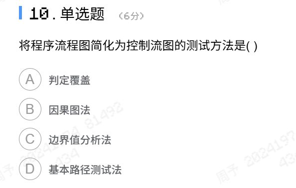

**解答**：D（基本路径测试法）

**解析**：基本路径测试法是在程序控制流图基础上，通过分析环形复杂性来设计测试用例的方法。

### 21. 第13题 条件覆盖与判定覆盖的关系 ⭐

**解答**：B（错）

**解析**：条件覆盖只保证每个条件取真取假，不保证判定结果真假，故不能兼顾判定覆盖。

### 22. 第14题 基本路径测试属于哪种测试

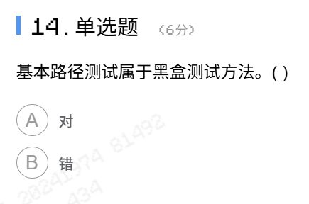

**解答**：B（错）

**解析**：基本路径测试基于程序内部逻辑结构设计用例，属于白盒测试方法，故题干说法错误。

### 23. 第15题 条件覆盖与分支覆盖关系 ⭐

**解答**：B（错）

**解析**：条件覆盖只保证每个条件取真假值，不保证判断结果的真假，无法兼顾分支覆盖。

### 24. 环路复杂度与独立路径数关系 ⭐

**解答**：C（3）

**解析**：环形复杂度V(G)的值直接等于独立路径的条数。
